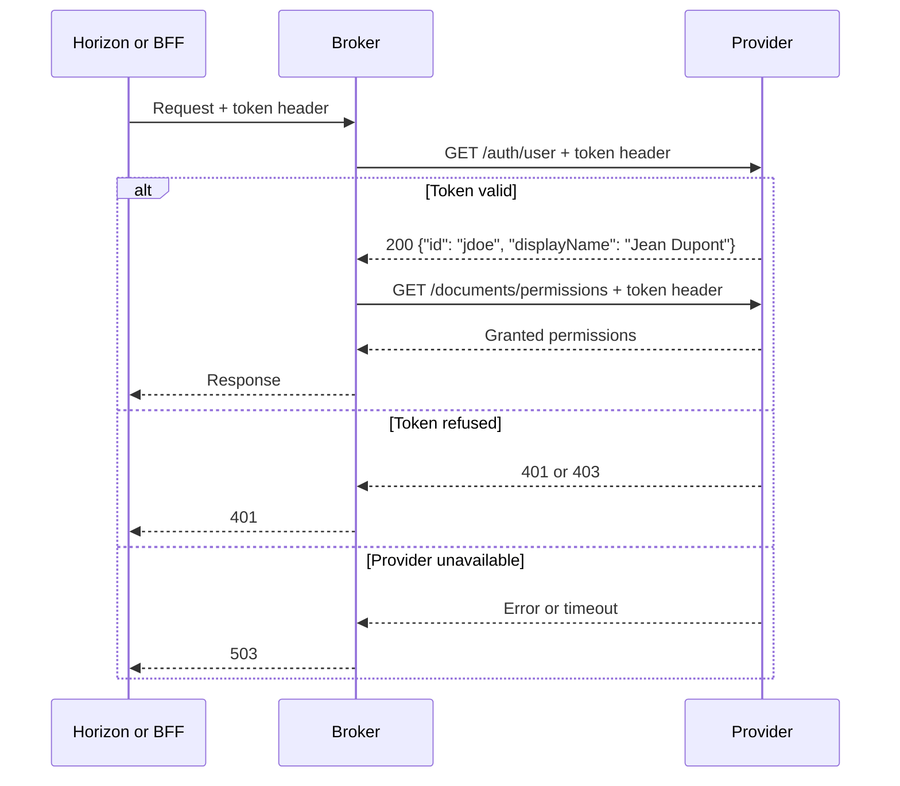

# Security

With ARender Horizon, the viewer runs in the user's browser and calls the Document Service Broker. Security is enforced on the broker:

- **Authentication**: the broker identifies the user, from a JWT or from a token that a provider validates.
- **Permissions**: for each document, the broker asks the provider what the user may do, and enforces it. See [Permissions](../guides/features/permissions.md).
- **Watermarks and redactions**: the broker serves watermarked or redacted copies to the users who may not get the clean content. See [Watermarks](../guides/features/watermarks.md).

## Authentication modes

The broker accepts three modes, set in its configuration:

| Mode                          | Configuration                                                                           | The user is identified by                                                      |
| ----------------------------- | --------------------------------------------------------------------------------------- | ------------------------------------------------------------------------------ |
| No authentication             | `arender.security.enabled=false` (default)                                              | Nobody: requests are served without a user.                                    |
| JWT                           | `arender.security.enabled=true` and the issuer of the tokens                            | The JWT in the `Authorization: Bearer` header.                                 |
| Token validated by a provider | `arender.security.provider-token.header` and `arender.security.provider-token.provider` | The token in the configured header, validated by the provider on each request. |

Per-user permissions and watermarks need an identified user:

- `{user.name}` in a watermark is filled with the user's name, or `Unknown` without an identified user.
- The broker stamps the author and the modification author of each annotation with the user's login. Without an identified user, it keeps the values the client sends.

### JWT

The broker validates the JWT as an OAuth2 resource server:

```yaml title="application.yml (broker)"
arender:
    security:
        enabled: true
spring:
    security:
        oauth2:
            resourceserver:
                jwt:
                    issuer-uri: https://idp.example.com/realms/arender
```

With `arender.security.enabled=true`, every request needs a valid JWT, or the provider token described below. Other requests get `401`. Health endpoints stay public.

The browser does not hold the token itself: a Backend For Frontend (BFF) adds it to each request. See [Authentication and BFF](../installation/configuration.md#authentication-and-bff).

The user's login is the `preferred_username` claim, else `sub`. The user's name, used in watermarks, is the `name` claim, else `preferred_username`, else `sub`.

### Token validated by a provider

Since 2026.5.0, the broker can delegate authentication to a provider. Use this mode when the repository issues its own tokens, or when the provider already validates the user's credentials.

```yaml title="application.yml (broker)"
arender:
    security:
        provider-token:
            header: Authorization
            provider: filenet
```

| Property                                   | Description                                                                                                                                          |
| ------------------------------------------ | ---------------------------------------------------------------------------------------------------------------------------------------------------- |
| `arender.security.provider-token.header`   | The request header carrying the token. `Authorization` is allowed: the provider then validates every bearer token instead of the broker's JWT check. |
| `arender.security.provider-token.provider` | The [registry provider](../guides/integration/providers.md) that validates the token. It must be declared under `registry.providers`.                |

Set both properties together. The broker refuses to start when only one is set, when the header is blank, or when the provider is not declared.

For each request carrying the header, the broker calls `GET /auth/user` on the provider, with the same header:



| Provider answer to `GET /auth/user`             | Broker response                                              |
| ----------------------------------------------- | ------------------------------------------------------------ |
| `200` with a user `id`                          | The request is served for that user.                         |
| `401` or `403`, or no `id`                      | `401`.                                                       |
| Any other status, a timeout, a connection error | `503`: the request is refused, never served unauthenticated. |

The broker forwards the token, under its original header name, only to the provider that validated it. The token is never put in a URL.

The validating provider always comes from this configuration. The `X-Provider-ID` header never changes it.

Each request is validated: the broker does not keep the result between requests.

Among the shipped providers, FileNet answers `GET /auth/user` in its OAuth2 mode (`oauth2ObjectStoreProvider`). A custom provider implements [`GET /auth/user`](../reference/rest-api/provider-api.md#retrieve-the-current-user) to support this mode.

### Classic and Horizon on one broker

The Classic viewer calls the broker without a user token. To serve both viewers from one broker, keep `arender.security.enabled=false` and set `arender.security.provider-token`:

- Requests carrying the configured header are validated by the provider, as above. The token is forwarded to the provider.
- Requests without the header are served without authentication, as for the Classic viewer.

## Related pages

- [Permissions](../guides/features/permissions.md)
- [Watermarks](../guides/features/watermarks.md)
- [Advanced configuration](../installation/configuration.md#authentication-and-bff)
- [Provider API](../reference/rest-api/provider-api.md)
- [Rendition configuration](../reference/rendition-properties.md#permissions-watermarks-and-redactions)
