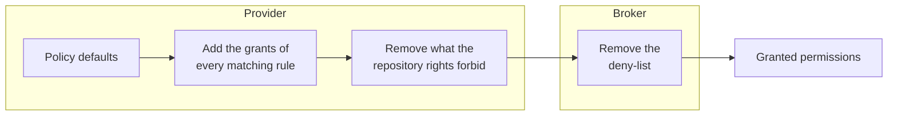

# Permissions

Since 2026.5.0, ARender Horizon applies per-user and per-document permissions defined by your repository. They control who may open a document, download it, print it, annotate it, see through its redactions, or get it without a [watermark](./watermarks.md).

## How it works

Three components take part:

- **The provider decides.** For each user and document, it evaluates a [permission policy](#permission-policy) against what the repository says about the user: their groups, their roles and their rights on the document. It answers the set of permissions it grants.
- **The broker enforces.** On every request that names a document, it asks the provider for the user's permissions. It then refuses the request (HTTP `403`), or serves a watermarked or redacted copy of the document.
- **Horizon adapts.** When a document set opens, the viewer reads the user's permissions on each document and only offers the actions the user may perform.

:::warning Hiding an action is not a protection
Horizon hides buttons and menu entries for convenience. The protection is the broker's check: a client that calls the broker directly gets the same refusals and the same watermarked or redacted copies.
:::

A permission the provider does not grant is refused. Permissions apply to the documents opened through a [provider](../integration/providers.md).

A provider that does not implement the permissions endpoint grants every permission, except the ones withdrawn by the [broker deny-list](#broker-deny-list). Custom providers written for an earlier version keep working unchanged.



## Permission reference

| Permission              | Allows                                                                                                                                                   | Without it                                                                                                                                                               |
| ----------------------- | -------------------------------------------------------------------------------------------------------------------------------------------------------- | ------------------------------------------------------------------------------------------------------------------------------------------------------------------------ |
| `DOCUMENT_READ`         | Being served the document in any form: pages, thumbnails, text, search, annotations.                                                                     | Every request on the document is refused. Every other permission is useless without this one.                                                                            |
| `DOWNLOAD`              | Downloading the source file, in its original format or as an archive.                                                                                    | The original format is not offered, and its download is refused.                                                                                                         |
| `DOWNLOAD_RENDERED`     | Downloading the document converted to another format, including PDF.                                                                                     | The PDF export is not offered, and its download is refused.                                                                                                              |
| `PRINT`                 | Printing the document.                                                                                                                                   | The print button is hidden, and printing is refused.                                                                                                                     |
| `VIEW_UNMARKED`         | Viewing the pages without the view watermark.                                                                                                            | Pages and thumbnails carry the view watermark.                                                                                                                           |
| `DOWNLOAD_UNMARKED`     | Downloading without the download watermark.                                                                                                              | Downloaded PDFs carry the download watermark. A download that cannot carry a watermark is refused: a source file other than PDF, an archive, or a format other than PDF. |
| `PRINT_UNMARKED`        | Printing without the print watermark.                                                                                                                    | The printed document carries the print watermark.                                                                                                                        |
| `DOCUMENT_UPLOAD`       | Uploading a document to the broker (`POST /documents`). It is asked of the provider named by `X-Provider-ID`, else of the default provider.              | The upload is refused.                                                                                                                                                   |
| `DOCUMENT_CREATE`       | Reserved for upcoming features. No effect in 2026.5.                                                                                                     |                                                                                                                                                                          |
| `VERSION_CREATE`        | Reserved for upcoming features. No effect in 2026.5.                                                                                                     |                                                                                                                                                                          |
| `ANNOTATION_READ`       | Reading the annotations and comments of the document.                                                                                                    | The comments panel is hidden. The user only receives the redactions and the page rotations.                                                                              |
| `ANNOTATION_CREATE`     | Creating annotations, comments and replies. It is also the upper limit for updating and deleting annotations: see [Annotation flags](#annotation-flags). | The annotation tools are hidden, and creating an annotation is refused.                                                                                                  |
| `REDACTION_CREATE`      | Creating redactions. It is also the upper limit for updating and deleting redactions.                                                                    | Creating a redaction is refused.                                                                                                                                         |
| `REDACTION_SEE_THROUGH` | Being served the original content under the redactions.                                                                                                  | The user is served a copy with the redactions burned in. See [Redactions](#redactions).                                                                                  |

## Permission policy

The Alfresco, FileNet and M-Files providers evaluate a permission policy set in their Spring configuration (`application.yml` or `application.properties`), under `arender.permissions`. Each provider ships a default policy, described in its guide:

- [Alfresco: Permissions](../integration/alfresco.md#permissions)
- [FileNet: Permissions](../integration/filenet.md#permissions)
- [M-Files: Permissions](../integration/m-files.md#permissions)

The policy is read once at startup: restart the provider to apply a change. A successful load is logged as:

```
Loaded permission policy: 9 defaults, 3 rules, 2 annotation rules
```

### How permissions are computed

For each user and document, the provider:

1. Grants the `defaults`.
2. Adds the `grant` of every rule whose conditions match the user.
3. Removes each permission the user's rights on the document do not allow, whatever the policy grants (see [Repository limits](#repository-limits)).

The broker then removes the permissions listed in its [deny-list](#broker-deny-list).

### Example

```yaml title="application.yml (provider)"
arender:
    permissions:
        facts-cache-ttl: 60s
        policy:
            defaults:
                - DOCUMENT_READ
                - ANNOTATION_READ
                - VIEW_UNMARKED
            rules:
                - name: legal team downloads and prints without watermarks
                  when:
                      groups: [GROUP_legal]
                  grant: [DOWNLOAD, DOWNLOAD_RENDERED, PRINT, DOWNLOAD_UNMARKED, PRINT_UNMARKED]
                - name: other users print with a watermark
                  grant: [PRINT]
                - name: users who may update the document annotate it
                  when:
                      rights: [ANNOTATE]
                  grant: [ANNOTATION_CREATE]
            annotation-rules:
                - name: managers moderate the annotations
                  when:
                      roles: [SiteManager]
                  grant: [ANNOTATION_UPDATE, ANNOTATION_DELETE]
```

This example targets the Alfresco provider: the FileNet provider does not support the `roles` condition. With this policy, every user may view the documents they can read in the repository, with the view watermark. Members of `GROUP_legal` also download and print without watermarks. Other users print with the print watermark and cannot download.

### Properties

| Property                                      | Type                | Default           | Description                                                                                                                                                  |
| --------------------------------------------- | ------------------- | ----------------- | ------------------------------------------------------------------------------------------------------------------------------------------------------------ |
| `arender.permissions.facts-cache-ttl`         | Duration            | `60s`             | How long the groups, roles and rights of a user on a document are reused. It is also the time a change of groups or rights in the repository takes to apply. |
| `arender.permissions.policy.defaults`         | List of permissions | Provider-specific | Permissions granted to every user.                                                                                                                           |
| `arender.permissions.policy.rules`            | List of rules       | Provider-specific | Rules granting more permissions to the users they match.                                                                                                     |
| `arender.permissions.policy.annotation-rules` | List of rules       | Provider-specific | Rules granting what a user may do to the annotations other users created. See [Annotation rules](#annotation-rules).                                         |

Each rule has three keys:

| Key     | Description                                                                                              |
| ------- | -------------------------------------------------------------------------------------------------------- |
| `name`  | A label for the rule, shown in the startup error messages.                                               |
| `when`  | The conditions the user must match. A rule without `when` matches every user.                            |
| `grant` | The permissions the rule grants (`rules`), or the annotation permissions it grants (`annotation-rules`). |

### Conditions

| Condition | Matches                                                                                                                                             |
| --------- | --------------------------------------------------------------------------------------------------------------------------------------------------- |
| `groups`  | The groups of the user in the repository.                                                                                                           |
| `roles`   | The roles of the user on the document.                                                                                                              |
| `rights`  | The rights of the user on the document: `READ`, `WRITE`, `DELETE`, `VERSION`, `ANNOTATE`. Each provider maps them from the repository's own rights. |

Within one condition, the rule matches when the user has **any** of the listed values. When a rule has several conditions, the user must match **all** of them.

Which conditions a provider supports, and where their values come from, depends on the repository:

| Provider | `groups`                                           | `roles`                                                  | `rights` |
| -------- | -------------------------------------------------- | -------------------------------------------------------- | -------- |
| Alfresco | Yes: the `GROUP_…` authorities of the ticket owner | Yes: the site role, and the roles the document ACL gives | Yes      |
| FileNet  | Yes: the short or full names of the user's groups  | No                                                       | Yes      |

The provider guides list how each right is mapped.

### Repository limits

Some permissions also need a right on the document, whatever the policy grants. The repository decides whether a document may be read or written:

| Permission                                                                      | Needs the right |
| ------------------------------------------------------------------------------- | --------------- |
| `DOCUMENT_READ`                                                                 | `READ`          |
| `ANNOTATION_CREATE`, `REDACTION_CREATE`                                         | `ANNOTATE`      |
| `VERSION_CREATE`                                                                | `VERSION`       |
| `ANNOTATION_UPDATE`, `ANNOTATION_DELETE`, `REDACTION_DELETE` (annotation rules) | `WRITE`         |
| `REDACTION_UPDATE` (annotation rules)                                           | `ANNOTATE`      |

### Annotation rules

A user who may create annotations may always update and delete their own. `annotation-rules` grant what a user may do to the annotations **other users** created:

| Annotation permission | Allows                                                |
| --------------------- | ----------------------------------------------------- |
| `ANNOTATION_UPDATE`   | Updating the annotations and comments of other users. |
| `ANNOTATION_DELETE`   | Deleting the annotations and comments of other users. |
| `REDACTION_UPDATE`    | Updating the redactions of other users.               |
| `REDACTION_DELETE`    | Deleting the redactions of other users.               |

The provider turns them into the [flags](#annotation-flags) of each annotation it returns.

### Changing the shipped policy

Set `defaults`, `rules` or `annotation-rules` in your own provider configuration, for example a mounted `application.yml` or a Kubernetes ConfigMap.

- Each one you set **replaces** the shipped list as a whole. The lists are not merged.
- A custom `defaults` must include `DOCUMENT_READ`. Without it, nobody can open any document.
- To remove the shipped rules, set a single rule that grants nothing:

    ```properties
    arender.permissions.policy.rules[0].name=none
    arender.permissions.policy.rules[0].grant=
    ```

    The same works for `annotation-rules`.

The provider refuses to start on an invalid policy. The error message names the faulty key. Startup fails on:

- an unknown permission, right or key;
- a condition the provider does not support;
- a condition without any value, such as `groups: []`.

### Broker deny-list

The broker can withdraw permissions from every user of a provider, whatever the provider grants. Set it in the broker configuration:

```yaml title="application.yml (broker)"
registry:
    providers:
        alfresco:
            denied-permissions:
                - DOWNLOAD
                - DOWNLOAD_RENDERED
```

The deny-list can only remove permissions. Never put `DOCUMENT_READ` in it: that blocks every document of the provider.

## Annotation flags

The provider sets three flags on each annotation it returns, computed for the user who asks:

| Flag        | When set                                                                                          |
| ----------- | ------------------------------------------------------------------------------------------------- |
| `readonly`  | The user may not update the annotation: move, resize, recolor, edit its text.                     |
| `locked`    | The user may not delete the annotation.                                                           |
| `obfuscate` | On a redaction only: the redaction stays opaque, even for a user granted `REDACTION_SEE_THROUGH`. |

A refusal at either level wins. Updating an annotation needs `ANNOTATION_CREATE` (or `REDACTION_CREATE` for a redaction) **and** the annotation not `readonly`. Deleting it needs the create permission **and** the annotation not `locked`.

- Deleting a comment also deletes its replies. If the user may not delete one of the replies, the comment is reported `locked`.
- Page rotations are never restricted: any user who may view the document may rotate its pages, and the rotation is saved.
- The broker checks every update and delete against the stored annotation. The flags a browser sends are ignored.

:::note
A provider that sets no flags lets every user holding `ANNOTATION_CREATE` update and delete every annotation.
:::

## Redactions

The broker enforces the redactions stored with a document:

- Every user receives the redactions of a document, even without `ANNOTATION_READ`.
- A user without `REDACTION_SEE_THROUGH` is served a copy of the document with the redactions burned in. The covered content is removed from the page images, the text, the search results, the printed document and the downloaded files.
- A user with `REDACTION_SEE_THROUGH` is served the original content. A redaction flagged `obfuscate` stays burned in for them too.
- Downloading the source file of a redacted document needs `REDACTION_SEE_THROUGH`, unless the source is a PDF: a PDF source is served with the redactions burned in. Other source formats, and archives, are refused.

Redactions changed directly in the repository are seen after `redaction.on-the-fly.route-ttl-ms` (10 minutes by default). See [Rendition configuration](../../reference/rendition-properties.md#permissions-watermarks-and-redactions).

## What users see in Horizon

| Permission or flag                       | Effect in the viewer                                                                                                                                                                                                                                                                                                           |
| ---------------------------------------- | ------------------------------------------------------------------------------------------------------------------------------------------------------------------------------------------------------------------------------------------------------------------------------------------------------------------------------ |
| `DOCUMENT_READ`                          | Without it, the document does not open. A spreadsheet opens in its data view only with `DOCUMENT_READ`; otherwise it opens in page view.                                                                                                                                                                                       |
| `DOWNLOAD`, `DOWNLOAD_RENDERED`          | The download dialog offers the original format with `DOWNLOAD`, and the PDF export with `DOWNLOAD_RENDERED`. The download button is hidden when neither is granted.                                                                                                                                                            |
| `PRINT`                                  | The print button shows only when the displayed document may be printed. Printing all the documents of a set prints the permitted ones and names the others.                                                                                                                                                                    |
| `ANNOTATION_READ`                        | The comments panel and its button show when at least one document of the set grants it.                                                                                                                                                                                                                                        |
| `ANNOTATION_CREATE`                      | Gates the annotation tools, highlighting from a text selection, duplicating, replying, and resolving or reopening a comment. With several documents side by side, a tool stays available while one of the displayed documents allows it; over a page whose document refuses it, the pointer shows "No permission to annotate". |
| `readonly`                               | The annotation cannot be moved, resized, recolored or edited.                                                                                                                                                                                                                                                                  |
| `locked`                                 | The annotation cannot be deleted.                                                                                                                                                                                                                                                                                              |
| `VIEW_UNMARKED` and the other clearances | The watermarks are drawn by the broker into what it serves. See [Watermarks](./watermarks.md).                                                                                                                                                                                                                                 |

Files inside an archive or an email follow the permissions of their source document. Each document of a set opened from several URLs has its own permissions.

## When changes apply

A change of permissions does not reach a user immediately:

| Change                                                  | Applies after                                                                               |
| ------------------------------------------------------- | ------------------------------------------------------------------------------------------- |
| Groups, roles or rights changed in the repository       | `arender.permissions.facts-cache-ttl` on the provider (60 seconds by default).              |
| Permission policy changed                               | A restart of the provider.                                                                  |
| A view clearance revoked, or the view watermark changed | `watermark.on-the-fly.route-ttl-ms` on the broker (10 minutes by default), for page images. |
| Redactions changed directly in the repository           | `redaction.on-the-fly.route-ttl-ms` on the broker (10 minutes by default).                  |
| Buttons and menus shown in Horizon                      | The next opening of the document set: the viewer reads the permissions once per opening.    |

## Authentication

Per-user permissions and watermarks need to know who the user is. The broker identifies the user from a JWT or from a token validated by the provider, and the provider evaluates the policy for that user. See [Security](../../concepts/security-model.md).

:::info Upgrading from 2026.4

- **Uploads** need `DOCUMENT_UPLOAD`, which no shipped policy grants. With `registry.default-provider` set to a provider, add `DOCUMENT_UPLOAD` to its policy to keep uploads working.
- **A custom `defaults`** must list `DOCUMENT_READ`. Without it, every document request is refused.
- **Annotation flags**: a custom provider that sets no `readonly` or `locked` flags lets every user holding `ANNOTATION_CREATE` update and delete every annotation. See [Provider API: Annotation flags](../../reference/rest-api/provider-api.md#annotation-flags).
- **Annotation endpoints**: a custom provider without annotation storage must answer `501 Not Implemented` on `GET /annotations`. A `404` now fails the request.
- **JavaScript API**: `download` and the annotation commands now raise `FORBIDDEN` when the user lacks the permission, and `NOT_READY` until the permissions have arrived. See [JavaScript API: Errors](../../reference/javascript-api.md#errors).
- **Custom providers** without the permissions endpoint keep working: the broker grants every permission except its deny-list.
  :::

## Related pages

- [Watermarks](./watermarks.md)
- [Security](../../concepts/security-model.md)
- [Provider API](../../reference/rest-api/provider-api.md)
- [Broker API](../../reference/rest-api/broker-api.md)
- [Rendition configuration](../../reference/rendition-properties.md#permissions-watermarks-and-redactions)
