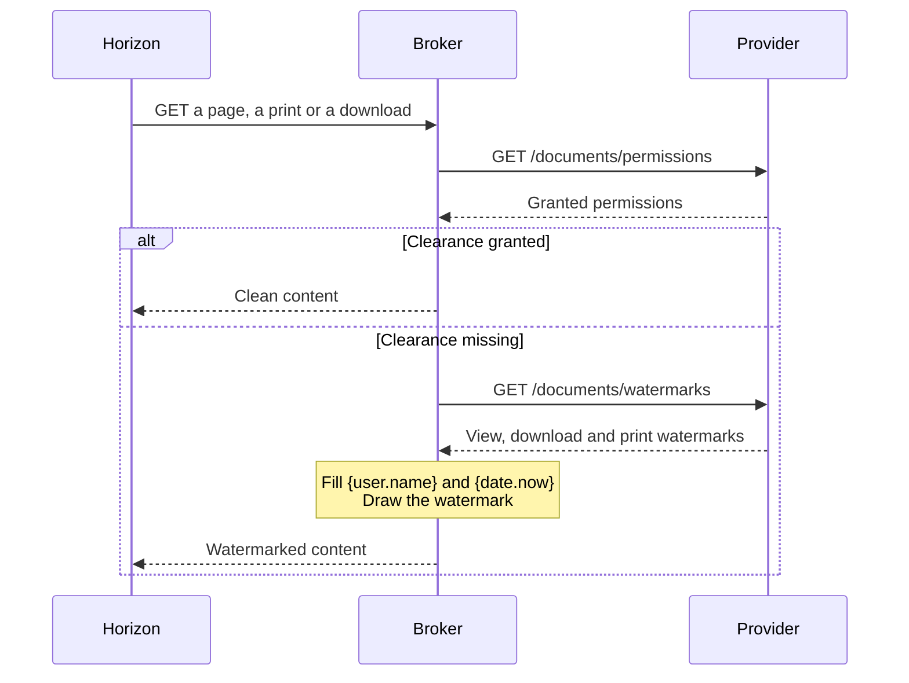

# Watermarks

Since 2026.5.0, ARender Horizon watermarks the documents a user views, downloads or prints when the user is not cleared to get them clean. The watermark is drawn by the broker into the content it serves. A user who is not cleared is never served the clean copy, whichever client asks.

## Three watermarks, three clearances

Each action has its own watermark, and its own clearance in the [permission policy](./permissions.md#permission-policy):

| Action   | Watermark applied without | Built-in text                                                 |
| -------- | ------------------------- | ------------------------------------------------------------- |
| View     | `VIEW_UNMARKED`           | `Viewed by {user.name} at {date.now#yyyy/MM/dd HH:mm}`        |
| Download | `DOWNLOAD_UNMARKED`       | `Downloaded by {user.name} at {date.now#yyyy/MM/dd HH:mm:ss}` |
| Print    | `PRINT_UNMARKED`          | `Printed by {user.name} at {date.now#yyyy/MM/dd HH:mm:ss}`    |

The clearances alone decide who gets a watermark. The shipped policies of the Alfresco, FileNet and M-Files providers grant the three clearances to every user, so nothing is watermarked out of the box.

To watermark a user's view, remove `VIEW_UNMARKED` from what the policy grants them. For example, to watermark every view but let a group of users download and print without watermarks:

```yaml title="application.yml (provider)"
arender:
    permissions:
        policy:
            defaults:
                - DOCUMENT_READ
                - DOWNLOAD
                - DOWNLOAD_RENDERED
                - PRINT
                - ANNOTATION_READ
            rules:
                - name: compliance officers get clean copies
                  when:
                      groups: [GROUP_compliance]
                  grant: [DOWNLOAD_UNMARKED, PRINT_UNMARKED]
```

## What is watermarked



| Content requested                                                                   | Without the clearance                                    |
| ----------------------------------------------------------------------------------- | -------------------------------------------------------- |
| Page images and thumbnails                                                          | Drawn with the view watermark.                           |
| Printed document                                                                    | A PDF with the print watermark.                          |
| Download as PDF                                                                     | A PDF with the download watermark.                       |
| Download of the source file, when the source is a PDF                               | A PDF with the download watermark.                       |
| Download of a source file in another format, an archive, or a format other than PDF | Refused (`403`): these formats cannot carry a watermark. |
| Text, search results                                                                | Unchanged: the watermark is not part of the text.        |

The results of a comparison or a transformation are watermarked the same way when they are downloaded or printed.

The download and print copies are built for each request, so their date is to the second. The view copy is built once per viewing session.

In the spreadsheet data view, Horizon draws the view watermark over the grid. It asks the broker for it each time the data view shows, so the user name and date are current.

## Configuring the watermarks

The watermarks are set in the provider configuration, under `arender.watermarks`. Each watermark starts from its built-in value: set only the keys you change.

```yaml title="application.yml (provider)"
arender:
    watermarks:
        view:
            text: "Confidential - {user.name}"
            placement: TILED
            color: "#B00020"
        download:
            text: "Downloaded by {user.name} on {date.now#dd/MM/yyyy}"
```

| Key                                     | Description                                                                                       |
| --------------------------------------- | ------------------------------------------------------------------------------------------------- |
| `arender.watermarks.<action>.text`      | The text of the watermark. It may hold the [placeholders](#placeholders).                         |
| `arender.watermarks.<action>.placement` | `CENTER`, `TOP_LEFT` or `TILED`. See [Placement](#placement).                                     |
| `arender.watermarks.<action>.font-size` | Font size in points, for an A4 page width. It is scaled to the width of each page.                |
| `arender.watermarks.<action>.rotation`  | Rotation in degrees, clockwise.                                                                   |
| `arender.watermarks.<action>.color`     | Text color, as `#RRGGBB`.                                                                         |
| `arender.watermarks.<action>.opacity`   | Opacity, greater than 0 and at most 1. Defaults to `0.5`, or `0.2` when the placement is `TILED`. |

`<action>` is `view`, `download` or `print`. The built-in values are:

| Action   | Placement  | Font size | Rotation | Color     |
| -------- | ---------- | --------- | -------- | --------- |
| View     | `TILED`    | `14`      | `330`    | `#455A64` |
| Download | `CENTER`   | `30`      | `315`    | `#B00020` |
| Print    | `TOP_LEFT` | `10`      | `0`      | `#455A64` |

The watermarks are read once at startup, and apply to every document and every user of the provider. A successful load is logged as:

```
Loaded watermarks: view '…', download '…', print '…'
```

A watermark that cannot be drawn makes the provider fail at startup, with a message naming the key, for example:

```
arender.watermarks.view: Watermark color must be #RRGGBB: red
```

The same keys can be set as environment variables, such as `ARENDER_WATERMARKS_VIEW_TEXT`.

### Placeholders

| Placeholder            | Replaced with                                                                                                                                    |
| ---------------------- | ------------------------------------------------------------------------------------------------------------------------------------------------ |
| `{user.name}`          | The name of the authenticated user. It is `Unknown` when the broker has no authenticated user: see [Security](../../concepts/security-model.md). |
| `{date.now#<pattern>}` | The current date and time on the broker, formatted with a Java `DateTimeFormatter` pattern, such as `{date.now#dd/MM/yyyy}`.                     |
| `{date.now}`           | The current date and time, as `yyyy/MM/dd HH:mm:ss`.                                                                                             |

The placeholders use single braces. Write them as is in YAML, properties files, environment variables, Helm values and Docker Compose files. In YAML, quote the text when it starts with `{`.

An unknown placeholder, or a date pattern that cannot be read, is left as written.

`{user.name}` is filled with the user's display name when the identity provides one:

- With a JWT: the `name` claim, else `preferred_username`, else `sub`.
- With a token validated by the provider: the `displayName` the provider answers, else the user `id`.

### Placement

| Placement  | Drawing                                                                                               |
| ---------- | ----------------------------------------------------------------------------------------------------- |
| `CENTER`   | One watermark centred on the page.                                                                    |
| `TOP_LEFT` | One watermark in the top left corner.                                                                 |
| `TILED`    | The watermark repeated over the whole page, in a staggered grid. Watermarks at the page edge are cut. |

A single watermark (`CENTER` or `TOP_LEFT`) stays inside the page, with a 20-point margin. When the text is too long, the font shrinks down to 10 points, then the text wraps over several centred lines.

The watermark text is drawn with the font set in `annotation.textual.unicode.font.path` on the document converter, or Helvetica when it is not set. To watermark user names written in a script Helvetica cannot encode, set that font. See [Fonts](../../concepts/fonts.md).

## Broker settings

| Property                                | Default  | Description                                                                                                                                                                            |
| --------------------------------------- | -------- | -------------------------------------------------------------------------------------------------------------------------------------------------------------------------------------- |
| `watermark.on-the-fly.route-ttl-ms`     | `600000` | How long a viewing session keeps its view decision and its watermarked view copy. It is the time a revoked `VIEW_UNMARKED` or a changed view watermark takes to reach the page images. |
| `watermark.on-the-fly.build-timeout-ms` | `60000`  | How long a request waits for a watermarked copy to be built.                                                                                                                           |

Watermarking is always on: a user without a clearance always gets the watermarked copy.

## Custom providers

A custom provider sets its own watermarks by answering `GET /documents/watermarks`. A provider that does not implement it gets the built-in watermarks above. See [Provider API: Watermarks](../../reference/rest-api/provider-api.md#retrieve-the-watermarks).

## Related pages

- [Permissions](./permissions.md)
- [Security](../../concepts/security-model.md)
- [Provider API](../../reference/rest-api/provider-api.md)
- [Rendition configuration](../../reference/rendition-properties.md#permissions-watermarks-and-redactions)
