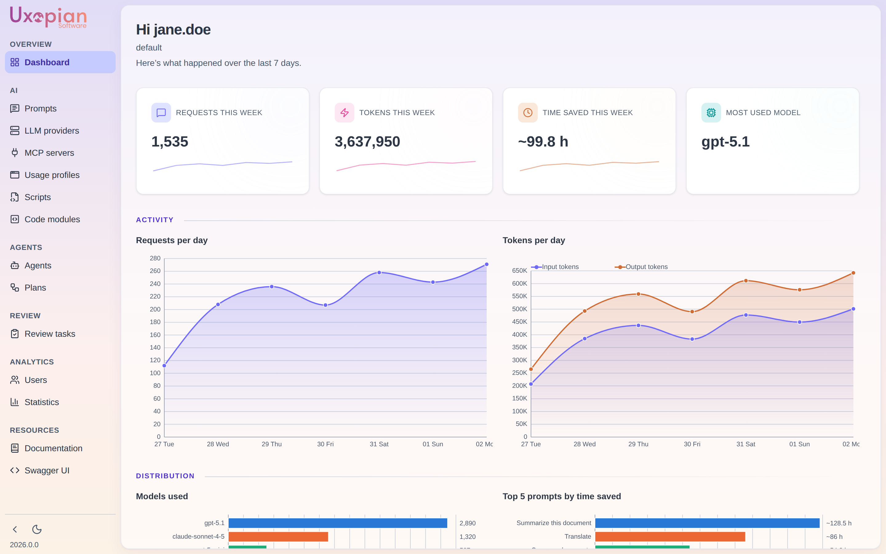
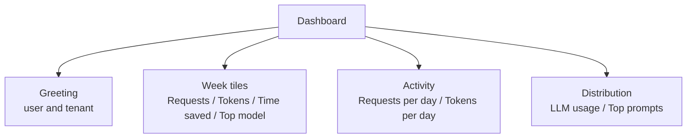

The dashboard is the landing page of the admin panel (route `/`). It greets the signed-in user, shows the tenant, and gives administrators a summary of the tenant's activity over the last week. The other sections are reached from the navigation rail, not from the dashboard.

*Figure: the dashboard.*

## Greeting

The page heading reads *Hi* followed by your user ID, with your tenant ID as subtitle. They come from `GET /api/v1/users/me`, which returns the `id` and `tenantId` of the authenticated caller.

## Week at a glance

Four tiles summarize the last week:

| Tile | Description |
|---|---|
| Requests this week | Number of LLM requests processed, with a sparkline |
| Tokens this week | Sum of input and output tokens, with a sparkline. Since 2026.0.0 it counts every completion of a tool-calling loop, not only the last one |
| Time saved this week | Time saved across all prompts, with a sparkline |
| Most used model | The model that served the most requests |

## Activity and distribution

- **Activity**: two charts, *Requests per day* and *Tokens per day*.
- **Distribution**: the LLM usage breakdown by model, and the top prompts by time saved.

Both sections use the same Stats API endpoints as the full [Statistics](./monitoring_statistics.md) page, with a `WEEK` interval.

*Figure: Dashboard layout.*

## Resource links

The **Documentation** and **Swagger UI** links are at the bottom of the navigation rail. Swagger UI opens the interactive API explorer; its address is resolved from the `swaggerEndpoint` attribute of the admin element when set, then from `apiEndpoint`, then from the address the panel is served at. Set `swaggerEndpoint` to aim the link at the gateway Ingress.

## Related pages

- [Admin panel overview](./admin_panel_overview.md)
- [Monitoring statistics](./monitoring_statistics.md)
