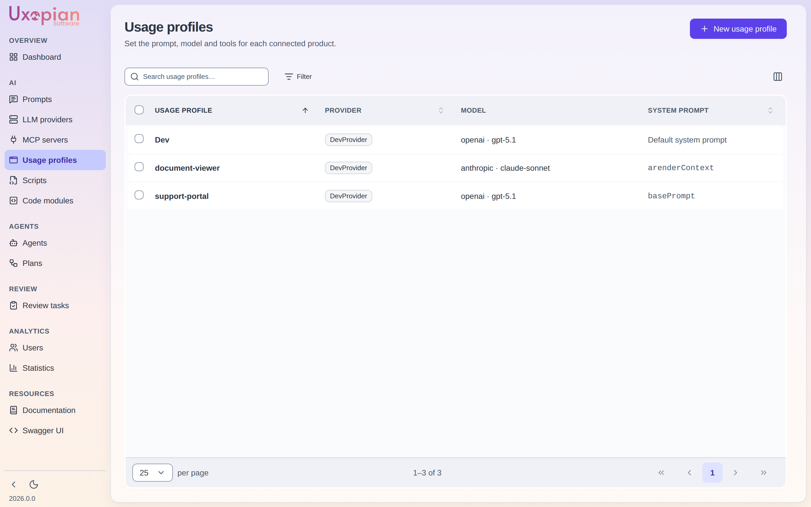
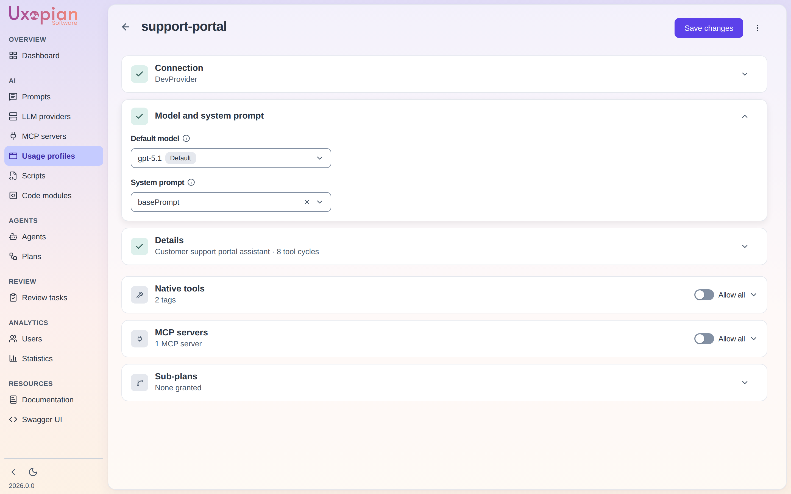

A **usage profile** scopes a set of AI defaults and guardrails — a default LLM provider/model, a system prompt, a maximum number of tool-calling cycles, and a tool/MCP permission whitelist — to one usage surface. A single uxopian-ai deployment can therefore serve several integrations with different defaults, without the surfaces stepping on each other's configuration.

:::warning[Renamed in 2026.0.0: Applications are now usage profiles]
Before 2026.0.0, usage profiles were called **Applications** (`ApplicationConf`, introduced in 2026.0.0-ft5). The rename is complete, with no compatibility layer:

- the admin section is **Usage profiles** (route `/usage-profiles`);
- the REST API moves from `/api/v1/admin/application/application-conf` to `/api/v1/admin/usage-profiles`;
- the `X-Application-Id` request header becomes `X-Usage-Profile-Id`;
- usage profiles are stored in a new `usage_profiles` OpenSearch index. The former `application_configurations` index is **not read** and existing Applications are **not migrated**: re-create them as usage profiles (tool whitelist, system prompt, default provider and model).
:::

## Why usage profiles: one deployment, two surfaces

Consider a deployment used by two very different audiences:

- **FlowerDocs** — end users asking questions about their documents from the FlowerDocs UI. High volume, interactive, and latency-sensitive.
- **A custom internal tool** — a back-office integration that calls uxopian-ai through its own connection provider to run longer, more autonomous analyses.

They want opposite settings. Without usage profiles, you either pick one compromise for the whole deployment, repeat the same overrides on every single request, or run a second deployment. With usage profiles, each surface carries its own configuration:

| | `FlowerDocs` usage profile | `InternalTool` usage profile |
|---|---|---|
| Default LLM provider / model | A fast, inexpensive model — most turns are simple document questions | A stronger reasoning model, worth its cost on a handful of runs |
| System prompt | End-user tone, answers grounded in the user's documents | Internal tone, output formatted for the calling system |
| Max tool cycles | Low — an interactive answer should not spin through dozens of tool round-trips | High — long agentic runs are the point |
| Permissions | Search and read tools only | Adds the internal MCP server and the Plans the tool is allowed to invoke |

The gain is twofold:

- **No cross-talk.** Raising the internal tool's tool-cycle ceiling, or granting it an MCP server, changes nothing for FlowerDocs users. Each surface has its own blast radius.
- **No per-request plumbing.** The FlowerDocs UI does not have to send a model name, a prompt, or a tool whitelist on every call — the request arrives through the `FlowerDocsProvider` connection provider and uxopian-ai resolves the matching usage profile on its own (see below).

## Every connection provider has a default usage profile

A usage profile is not opt-in plumbing you must wire up before anything works: **the first time a connection provider is used, uxopian-ai automatically creates a default usage profile for it** if none exists yet, named after the provider with any trailing `Provider` suffix stripped (`FlowerDocsProvider` → `FlowerDocs`, `AlfrescoProvider` → `Alfresco`). Creating a usage profile in the admin UI under that same derived name is how you customize the defaults for a provider without any other wiring.

The auto-created profile takes its default provider and model from `llm.default.provider` / `llm.default.model`; when those are unset, it takes the tenant's first LLM provider configuration and that provider's default model.

An explicit **`X-Usage-Profile-Id`** header on the request overrides this provider-derived lookup and forces a specific usage profile by id, regardless of which connection provider made the request.

## Navigate to usage profiles

In the admin panel, click **Usage profiles** in the navigation. The page lists every usage profile configured for the current tenant, with its connection provider, default model and system prompt. Clicking a row opens a quick view; double-clicking it (or choosing *Edit*) opens the editor.

*Figure: The usage profiles list — `default` was auto-created on first use; `FlowerDocs` was configured explicitly.*

## Fields

The editor is organized in cards that fold to a one-line summary once filled in.

| Field | Description |
|---|---|
| Usage profile name | The usage profile's ID. Required, unique per tenant, and immutable after creation. A name already used is reported while you type (`GET /api/v1/admin/usage-profiles/availability?id=`). |
| Connection provider | The connection provider (`ProviderId`, e.g. `FlowerDocsProvider`) this usage profile is associated with. This card is optional. |
| Default model | Default LLM provider and model. **Required**: a usage profile needs both a provider and a model. Used when the prompt of the turn names none — see [Resolution order](#resolution-order) below. |
| System prompt | A Prompt that **replaces** the default base prompt (`llm.default.base-prompt`) for conversations resolved to this usage profile. Leave unset to use the default base prompt. If the chosen prompt is missing or has no published version, the default base prompt is used and a warning is logged. |
| Description | Free-form description. |
| Max tool cycles | Caps the number of tool-calling round-trips for this usage profile (default: 10). |
| Permissions | The same tool/tag/MCP-server/sub-plan whitelist used elsewhere in the admin UI (see below). |

:::note The system prompt replaces the base prompt
In 2026.0.0, a usage profile's system prompt replaces the default base prompt instead of being added to it. A profile prompt that was written to complement the base prompt no longer receives its persona and safety rules: include them in the profile prompt if you still want them. Agents get no base prompt.
:::

### Permissions

The Permissions section is the same reusable editor used for agent configurations in [Managing Plans](./managing_plans.md): a whitelist of native tool names, a whitelist of tool tags (or "allow all tools"), a whitelist of MCP servers (or "allow all MCP servers"), a denylist of specific tools (which always wins, even over an allow-all), and — relevant if you use the [Agentic Plan engine](../understanding/agentic_plans.md) — a whitelist of Plans this usage profile is allowed to invoke as callable tools.

*Figure: A usage profile's configuration.*

When the tool whitelist or tags are applied, they cover every kind of tool: Java tools, MCP tools, plans exposed as tools and code tools.

## Resolution order

Request-level overrides no longer exist: the `llm_provider`, `llm_model`, `temperature` and `reasoning` query parameters of the request endpoints are ignored. For each turn, the provider and model are resolved independently, in this order:

1. **The prompt used in the current turn** — its `defaultLlmProvider`/`defaultLlmModel`.
2. **The resolved usage profile's** `defaultLlmProvider`/`defaultLlmModel`, when the prompt names no provider.

There is no further fallback: if neither the prompt nor the usage profile names a provider, the call fails with `No LLM provider for this call: set a default LLM provider on the usage profile '<id>' or on the prompt.` The system-wide `llm.default.provider` / `llm.default.model` properties only seed the usage profile that is auto-created for a connection provider.

The temperature, the *Can use tools* flag and the multimodal / function-calling requirements always come from the prompt; the maximum number of tool cycles comes from the usage profile. A conversation does not remember a model: a follow-up message without a prompt resolves again through the prompt (if any) and the usage profile, rather than inheriting the previous prompt's model.

## Deleting a referenced Prompt is blocked

A Prompt that is either the base prompt or referenced as a usage profile's system prompt cannot be deleted — the API returns a `409 Conflict` naming the usage profile(s) that reference it. Remove the reference from the usage profile (or delete the usage profile) first.

## REST API

All endpoints require the `ADMIN` role and operate on the current tenant.

| Method | Endpoint | Description |
|---|---|---|
| `GET` | `/api/v1/admin/usage-profiles` | List usage profiles — a paginated page of `{ collection, total, facets }`. Filters: `search`, `provider`, `model`; pagination: `offset`, `limit`, `orderBy`, `ascending` |
| `GET` | `/api/v1/admin/usage-profiles/{id}` | Get one usage profile |
| `GET` | `/api/v1/admin/usage-profiles/availability?id={id}` | `true` when a new usage profile can take this ID, `false` when it is taken or blank |
| `POST` | `/api/v1/admin/usage-profiles` | Create a usage profile — identified by its `id` only (`409` if it exists) |
| `PUT` | `/api/v1/admin/usage-profiles/{id}` | Update a usage profile |
| `DELETE` | `/api/v1/admin/usage-profiles/{id}` | Delete a usage profile |

## Related pages

- [Managing Plans](./managing_plans.md)
- [Agentic Plan engine](../understanding/agentic_plans.md)
- [Tools](../understanding/tools.md)
- [Multi-tenancy](../understanding/multi_tenancy.md)
- [Authentication](../understanding/authentication.md)
