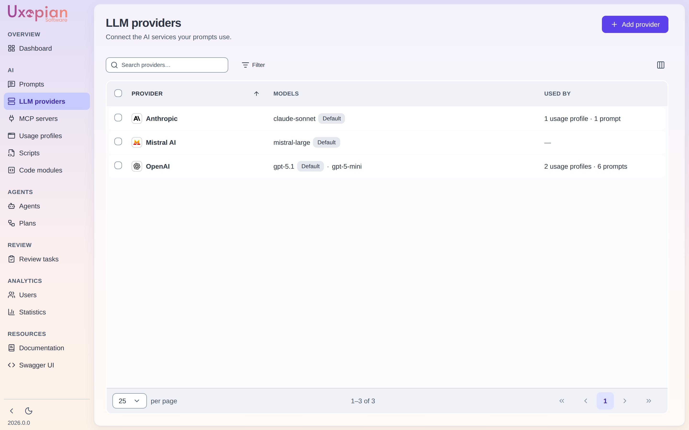
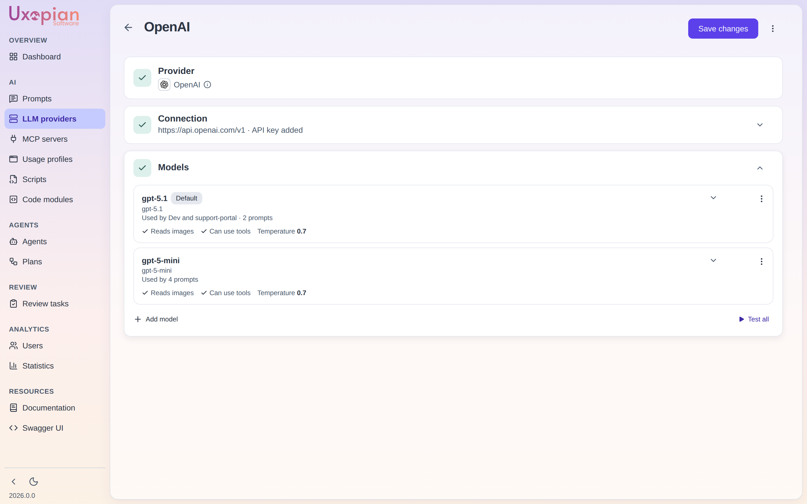
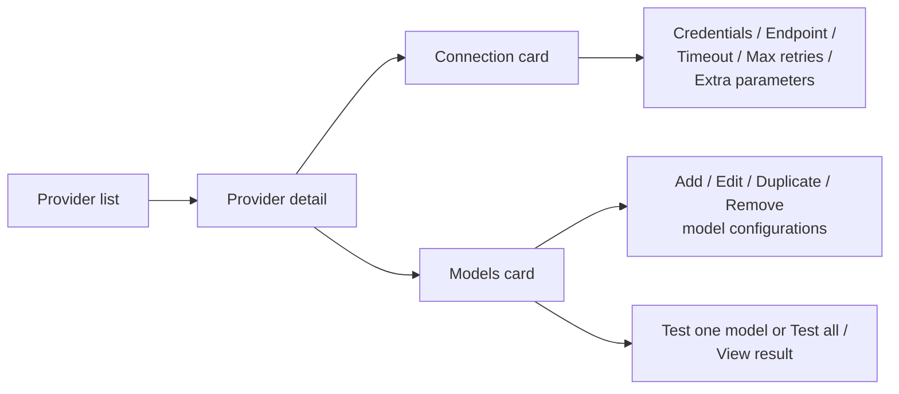

The LLM providers section of the admin panel lets you add, edit, and delete LLM provider configurations for the current tenant without restarting the application.

*Figure: the LLM Providers list — each provider shows its default model and the number of configured models.*

## Navigate to LLM providers

In the admin panel, click "LLM providers" in the navigation. The page lists the provider configurations of the current tenant — paginated, with server-side search and filters (provider type, model, whether an API key is set) and sorting. A *Used by* column names the usage profiles, agents and prompts that run on each provider, with a dash for an unused one. Single-click a row for a quick view, double-click it to edit.

## Add a provider

1. Click the "Add provider" button.
2. Select the provider type from the dropdown. Supported types: `openai`, `anthropic`, `azure`, `bedrock`, `gemini`, `mistral`, `huggingface`, `ollama`, `nu-extract`.
3. Fill in the required fields:
   - **API Secret**: the API key or credential. Stored encrypted.
   - **Endpoint URL**: the provider API base URL (required for some providers).
   - **Temperature**: sampling temperature (0.0 to 1.0+).
   - **Timeout**: request timeout (e.g., `60s`).
   - **Max retries**: number of retries on failure.
   - **Extra parameters**: provider-specific fields (e.g., `deploymentName` for Azure, `region` for Bedrock).
4. Add at least one model configuration:
   - **Model conf name**: internal identifier for this model.
   - **Model name**: actual model name sent to the provider API.
   - **Reads images** (`multiModalSupported`): check if the model accepts image inputs.
   - **Reads documents** (`documentSupported`, off by default): check if the model accepts documents. A document attached to a conversation is sent as a PDF only to models with this flag; otherwise the request is refused with `422 LLM_CAPABILITY_ERROR`.
   - **Can use tools** (`functionCallSupported`): check if the model supports tool calling.
   - **Max document size (MB)** (`maxDocumentSizeMb`, an advanced setting): the largest document this model accepts; a larger one is refused with `422 DOCUMENT_TOO_LARGE`. The global bound is `llm.document.max-size` (default 20 MB).
5. Save.

Changes take effect immediately for new requests. Existing in-progress requests continue using their original configuration.

## Provider detail page

Click on a provider in the list to open its detail page (route `/llm-providers/:id`). Since 2026.0.0 the page is made of three foldable cards — **Provider**, **Connection** and **Models** — instead of tabs, and every model can be tested from its own row.

*Figure: the provider detail page — provider id, default model, endpoint, API secret, and capability toggles.*

*Figure: Provider detail page structure.*

### Connection card

Edit the provider settings. The API secret field is masked; enter a new value only if you need to update the credential.

| Field | Description |
|---|---|
| Provider type | LLM provider backend (read-only after creation) |
| Provider name | Display name for the configuration |
| API Secret | Credential (masked, stored encrypted) |
| Endpoint URL | Base URL for the provider API |
| Temperature | Default sampling temperature |
| Timeout | Request timeout (e.g., `60s`) |
| Max retries | Retry count on failure |
| Extra parameters | Provider-specific fields (loaded from `GET /api/v1/admin/llm/providers/{name}/extra-params`) |

Extra parameters vary by provider type. For example, Azure requires `deploymentName`, Bedrock requires `region`.

### Models card

Manage the model configurations attached to this provider. Each model entry has:

| Field | Description |
|---|---|
| Model conf name | Internal identifier used when a prompt or usage profile selects this model |
| Model name | Actual model name sent to the provider API |
| Reads images | Whether the model accepts image inputs |
| Reads documents | Whether the model accepts documents (sent as PDF) |
| Can use tools | Whether the model supports tool calling |
| Advanced settings | Optional per-model generation settings (temperature, max output tokens, top p, top k, seed, penalties, max document size); empty means "inherit from the provider". Provider-declared options such as the NuExtract `project` or `output` appear here too |

Add new models, edit, duplicate or remove existing ones, and mark one as the default. A provider must have at least one model configuration. A model row shows what runs on it (*Used by*) and blocks its removal while it is in use.

### Testing a provider

Each model row has a **Test** button, and **Test all** tests every model of the provider. The result shows a success or error status and the answer preview. Under the hood, the admin UI calls `POST /api/v1/admin/llm/provider-conf/{id}/test?model={model}`, which sends a ping to one model of the provider (or its default model when `model` is omitted) and answers `{ model, answer }`.

Save the provider before testing it, since the test runs against the saved configuration.

If an LLM request fails because the provider reports an exhausted quota or credit balance, the API answers `402 LLM_QUOTA_EXCEEDED` instead of a generic `500`, and Chat and Quick Prompt display an explanation instead of "No response received". This is a billing matter on the provider side: top up the account, retrying will not help.

## Delete a provider

On the provider detail page, click "Delete". A confirmation dialog is displayed. Prompts and usage profiles that run on this provider will fail until they are pointed at another provider; the *Used by* column and `GET /api/v1/admin/llm/provider-conf/{id}/usage` tell which ones.

## Default provider and model

The provider and model of a conversation turn come from the prompt, then from the [usage profile](./managing_applications.md#resolution-order) of the calling surface. Both are set in the admin UI.

The `llm.default.provider` property (`LLM_DEFAULT_PROVIDER`) of `llm-clients-config.yml` is **no longer a call-time fallback**: since 2026.0.0 it only fills the usage profile that is auto-created the first time a connection provider is used. Changing it requires a configuration change and a restart, and has no effect on usage profiles that already exist.

## REST API endpoints

| Method | Endpoint | Description |
|---|---|---|
| `GET` | `/api/v1/admin/llm/providers` | List all available provider type names |
| `GET` | `/api/v1/admin/llm/providers/{name}/extra-params` | Get extra parameter descriptors for a provider type |
| `GET` | `/api/v1/admin/llm/provider-conf` | List provider configurations — a page `{ collection, total, facets }` of masked summaries (secrets hidden, with what runs on each model). Filters: `search`, `provider`, `model`, `hasApiKey`, `workspaceId`; pagination: `offset`, `limit`, `orderBy`, `ascending` |
| `GET` | `/api/v1/admin/llm/provider-conf/{id}/usage` | The usage profiles, agents and prompts that run on this provider |
| `POST` | `/api/v1/admin/llm/provider-conf/{id}/test` | Ping one model of the provider (`?model=`), or its default model |
| `POST` | `/api/v1/admin/llm/provider-conf` | Create a new provider configuration |
| `GET` | `/api/v1/admin/llm/provider-conf/{id}` | Get a provider configuration by ID (the full entity) |
| `PUT` | `/api/v1/admin/llm/provider-conf/{id}` | Update a provider configuration |
| `DELETE` | `/api/v1/admin/llm/provider-conf/{id}` | Delete a provider configuration |

## Related pages

- [LLM providers](../understanding/llm_providers.md)
- [Configure LLM providers](../how_to/configure_llm_providers.md)
- [Write a custom LLM client](../extending/custom_llm_client.md)
- [Configuration file reference (llm-clients-config.yml)](../reference/configuration.md#llm-clients-configyml)
- [Environment variables reference](../reference/environment_variables.md)
- [Admin panel overview](./admin_panel_overview.md)
