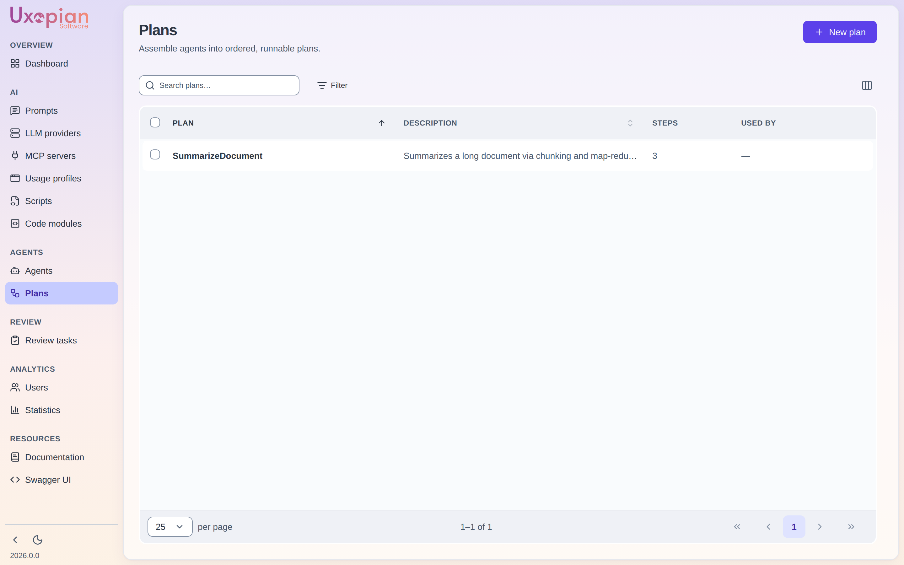
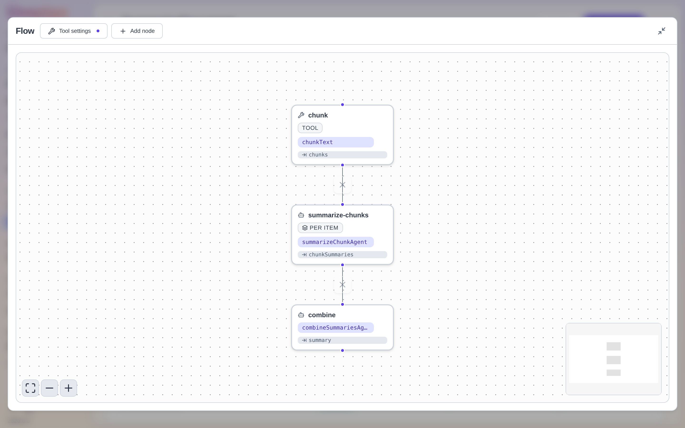
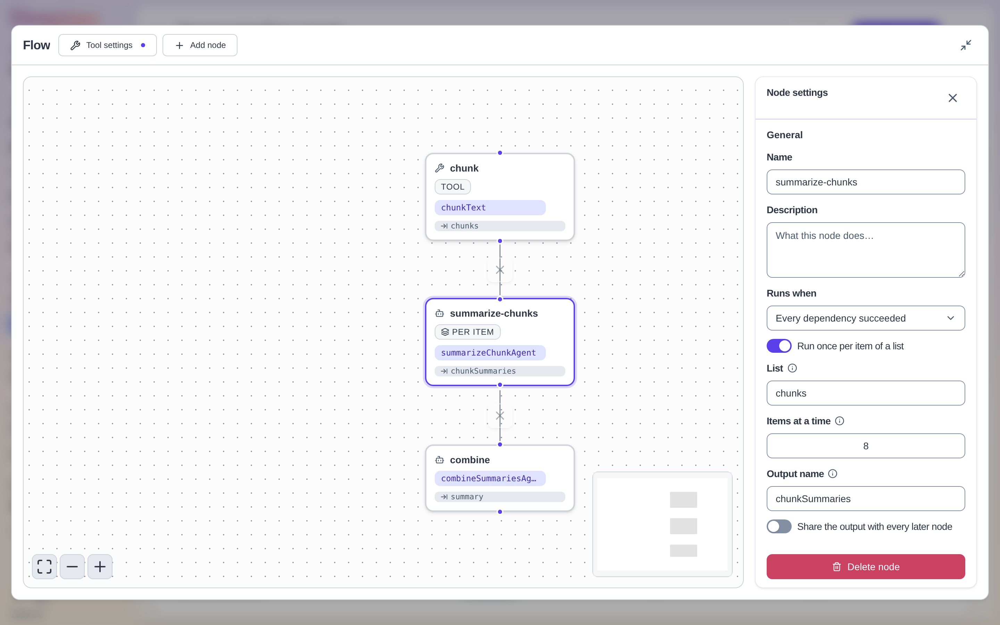
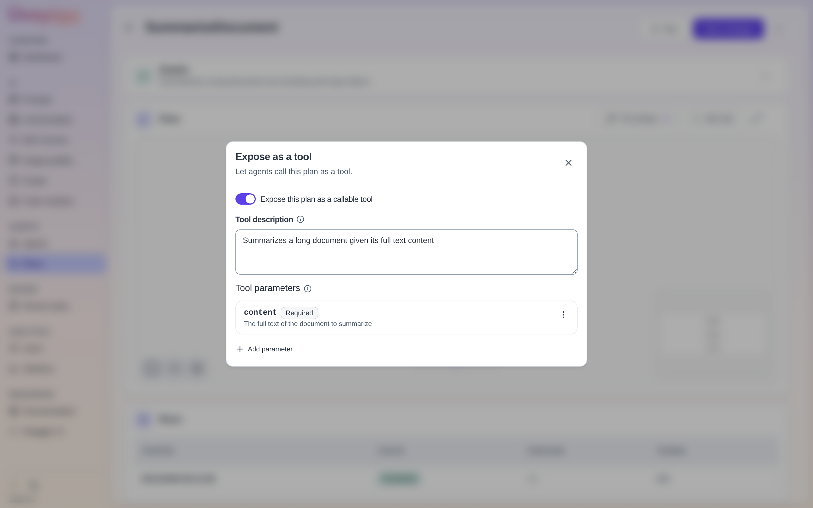
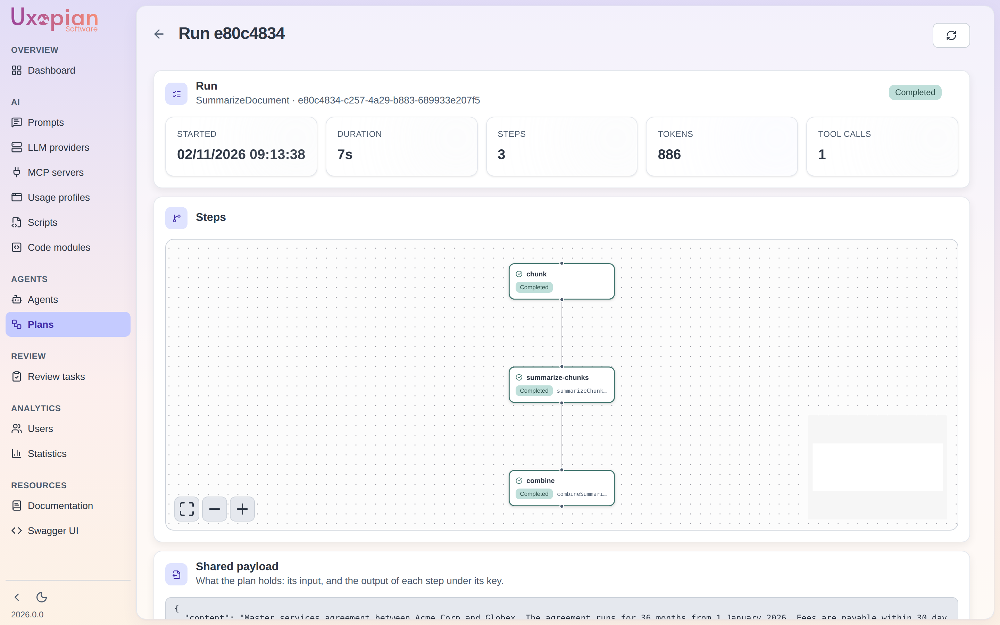

The **Plans** section of the admin panel lets you build, run, and monitor [Agentic Plans](../understanding/agentic_plans.md) — multi-step workflows of agent, tool and sub-plan nodes — through a visual flow editor, without writing the plan definition by hand.

## Navigate to Plans

In the admin panel, click *Plans* in the navigation. The page lists the plans of the current tenant — paginated, with server-side search, filters (agent, used by) and sorting — and a *New Plan* button. The columns are Plan, Description, Nodes, Output, Runs and Used by. Double-clicking a row opens the plan.

*Figure: The Plans list.*

## Create a plan

1. Click *New Plan*. The flow takes the whole page, with a floating toolbar on top: the plan name, **Settings**, **Runs of the plan** (with the number of active runs), and the buttons that add a node: **Agent**, **Tool**, **Sub-plan**.
2. Open **Settings** to set the **Plan name** (the plan's ID, immutable once saved; a name already in use is reported while you type) and an optional **Description**.
3. Add nodes, then drag from one node's edge to another to connect them — a connection sets a dependency: the target node waits for the source node to finish.
4. Select a node to open its **inspector**, a floating panel with its settings.
5. Click **Save changes**. It saves the plan together with the agents, prompts and code modules you edited from the inspector, and publishes those prompts and code modules. **Discard** drops every change. A pill lists the problems that block the save.

*Figure: A three-node plan — chunk (Tool) → summarize-chunks (Agent, fan-out) → combine (Agent).*

## Plan settings

**Settings** opens the *Plan settings* dialog:

| Tab | What it holds |
|---|---|
| Details | Plan name and description |
| Inputs | Named, typed inputs given when a run starts, each optional or required. The editor suggests names used inside the plan (a list or a tool argument) that no node produces |
| Output | The JSON Schema the run's output must match. Empty: no check |
| Limits | **Unique on**: inputs whose values must differ from every active run — starting a run with the same values is refused. **Token limit** with a period (*No period*, *Per day*, *Per month*): the token budget of the plan. **Run validity (minutes)**: how long a run may last; empty, the server default (24 h) |
| As a tool | **Let agents call this plan as a tool** and its **Tool description**, see [Expose a plan as a tool](#expose-a-plan-as-a-tool) |
| Runs | The last runs of the plan |

## Configure a node

The inspector has a **Node** tab for every node, plus **Agent** and **Prompt** tabs for an agent node, and a **Code** tab for a tool node. The Node tab holds:

| Field | Description |
|---|---|
| Name | Short label shown on the node in the graph |
| Run once per element of a list | Runs this node once per element of a list instead of once — see [Fan-out](#fan-out-run-a-node-once-per-list-element) below |
| Output name | The payload key under which this node's result is published |
| Share the output with every later node | When on, the output becomes visible to every downstream node, not just direct dependents |

The condition under which a node runs is set **on the link** that reaches it: *Every dependency succeeded* (default), *Some list elements failed*, *A dependency did not meet its criteria*, *A dependency did not succeed*, *Whatever the dependencies did*. The link shows it as *on success*, *on partial*, *on unmet criteria*, *on failure* or *always*. See [Agentic Plans — conditions](../understanding/agentic_plans.md#conditions-recovery-branches).

Each node type has its own fields:

- **Agent**: select an existing agent configuration, or create one without leaving the plan. The **Agent** tab edits the agent: its *description*, a list of **success criteria** entered one by one (the model gives a verdict on each, and any unmet criterion makes the node *unsatisfied*) and a *Max tool cycles* limit. The **Prompt** tab edits its **objective** prompt, which is required. An agent carries no model of its own: it runs on the provider, model and temperature of its objective prompt. The variables available to this node (dependency outputs, shared outputs, plan inputs, and — with fan-out — `item`) are highlighted in the prompt.
- **Sub-plan**: select another plan from this tenant. It runs as a child run.
- **Tool**: select a tool (grouped by tag) — a native tool, or a code module exposed as a tool. Each argument gets a source, listing every value available to this node (fan-out item, a dependency's output, a shared output, or a plan input). An argument left without a source takes the value of the same name (*Same name: x*).

### Fan-out: run a node once per list element

A node normally runs once. Turn on **Run once per element of a list** and it runs **once per element** of a JSON array already present in the payload, with several elements in flight at the same time — the *map* step of a map-reduce, expressed as a single node instead of one node per element.

| Field | Description |
|---|---|
| List | The payload key holding the JSON array to iterate. The array has to already be in the payload — published by an upstream node, or given as a plan input. In the figure below, a `chunk` tool node publishes its fragments under `chunks`, and the fan-out node's list is `chunks`. |
| Elements at a time | How many elements run in parallel. Empty: 32. Lower it when the LLM provider is rate-limited. A list is capped at 200 elements. |
| All or nothing | One failed element fails the whole node. Off by default: the node then ends *Partial* with the results of the elements that succeeded. |

What changes inside the node:

- **Each run gets an `item` variable** holding its own element, on top of the same payload every other node sees.
- **The node's output is a JSON array** of the per-element results, in the order of the input list — so a downstream node can read that one key and reduce the whole set in a single call.
- **Failed elements** are listed with their error. Unless *All or nothing* is on, the node fails only when every element fails.

For the underlying mechanics, see [Agentic Plans — Fan-out](../understanding/agentic_plans.md#fan-out-processing-a-list-in-parallel).

*Figure: Configuring a fan-out node — `chunks` is the list.*

## Expose a plan as a tool

In **Settings > As a tool**, turn on **Let agents call this plan as a tool** and write the **Tool description** an agent reads to decide when to use it. The plan's inputs (**Inputs** tab) become the tool's parameters.

A plan exposed this way is only callable by an agent whose configuration explicitly allows it — see [Agentic Plans — exposing a Plan as a tool](../understanding/agentic_plans.md#exposing-a-plan-as-a-tool).

*Figure: Exposing a plan as a tool.*

## Run a plan

Click *Run* (available once the plan is saved). If the plan declares inputs, a window collects a value for each (required ones are enforced) before starting. The run then opens in its own page. When the plan is *unique on* some inputs and a run with the same values is active, the start is refused with a link to that run.

## Monitor a run

**Runs of the plan** lists the plan's runs (newest first, loaded page by page). Opening one shows the run page:

- The **status** badge (*Running*, *Paused*, *Completed*, *Failed*, *Stopped*, *Expired*) and key figures: Started, Expires, Duration, Nodes, Tokens, Budget and Tool calls.
- A **Pause** button while running, **Resume** while paused, **Stop** while running or paused, and a refresh button. Pausing lets running nodes finish; resuming continues without re-running completed nodes; stopping moves the run permanently to *Stopped*, keeping the trace.
- A **Flow**, which can be expanded to full screen, with each node colored by its own status (*Pending*, *Ready*, *Waiting for children*, *Running*, *Completed*, *Partial*, *Unsatisfied*, *Failed*, *Skipped*, *Stopped*) and its token counts. Selecting a node opens its panel: start and end time, the condition it ran under, error message, whether a later node handled its failure, its **output**, its fan-out **elements**, its **child run**, its `log(...)` lines when it ran a code module, and every tool call it made. The selected node is kept in the URL (`?step=<id>`), so a link opens the run on that node.
- **Input**, **Payload** (the output of each node under its key), **Output** and **Output schema** cards, and the **Child runs** the run started.
- If the run failed, the reason is shown at the top. If the LLM provider reports an exhausted quota or credit balance (HTTP `402`), the whole run is aborted, and the failed node keeps the tokens the provider billed.

A run can be deleted once it has ended.

Token counts include every completion of a tool-calling loop, not only the last one.

*Figure: A completed run — each node's status is color-coded, and selecting a node opens its detail panel.*

## REST API

The admin UI is a thin wrapper around two controllers. All endpoints require the `ADMIN` role and operate on the current tenant.

**Plan definitions** — `/api/v1/admin/plans`

| Method | Path | Description |
|---|---|---|
| `GET` | `/` | List plans — a page `{ collection, total, facets }` of plan summaries (node count, `inputCount`, `hasOutputSchema`, agents and plans called, callers). Filters: `search`, `agentId`, `usedBy`, `workspaceId`; pagination: `offset`, `limit`, `orderBy`, `ascending` |
| `GET` | `/availability?id={id}` | `true` when a new plan can take this ID |
| `GET` | `/{id}` | Get one plan |
| `GET` | `/{id}/budget` | The plan's budget: `{ limit, period, used }`. `404` when the plan has none |
| `POST` | `/` | Create a plan. `201` with the stored plan |
| `PUT` | `/{id}` | Update a plan. `200` with the stored plan |
| `DELETE` | `/{id}` | Delete a plan |

**Plan runs** — `/api/v1/admin/plan-runs` (replaces `/api/v1/admin/plan-executions` since 2026.1.0)

| Method | Path | Description |
|---|---|---|
| `GET` | `/` | List runs, child runs included, newest first, as a page of summaries. Filters: `planId`, `status`, `workspaceId`, `callerRunId`; pagination: `offset`, `limit` |
| `GET` | `/{id}` | Get one run, with its node runs |
| `POST` | `/` | Start a run: `{ "planId": "...", "input": { ... } }`. `202 Accepted` with the run. `400` when an input is missing, undeclared, or the plan cannot start; `409 RUN_ALREADY_ACTIVE` with `existingRunId` for a unique plan |
| `POST` | `/{id}/signal` | `{ "signal": "PAUSE" \| "RESUME" \| "STOP" }`. Returns the run; `400` if the signal is missing or unknown, `404` if the run is unknown, `409` if its state does not allow the signal |
| `DELETE` | `/{id}` | Delete a run. `409` if it has not ended |

From 2026.0.0, the run JSON renamed `inputPayload` → `input`, `nodeExecutions` → `nodes`, `outputData` → `output`, `controlSignal` → `signal`, and the parent fields to a `caller` object; the signal body field `type` became `signal`, and the status `CANCELLED` became `STOPPED`. A plan definition uses `inputs` (was `toolInputParameters`), `condition` (was `executionCondition`) and the node type `TOOL` (was `DIRECT_TOOL`); the old names are still read.

## Related pages

- [Agentic Plans](../understanding/agentic_plans.md)
- [Tools](../understanding/tools.md)
- [Prompts and templating](../understanding/prompts_and_templating.md)
- [Configuration file reference](../reference/configuration.md)
