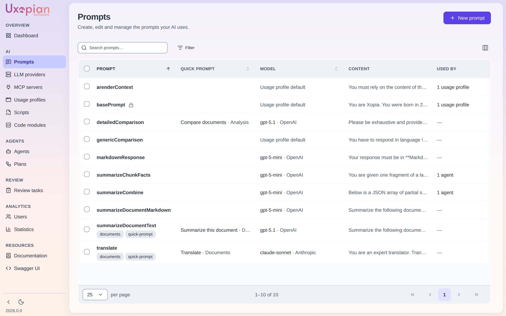
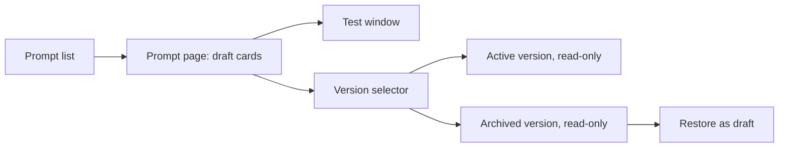
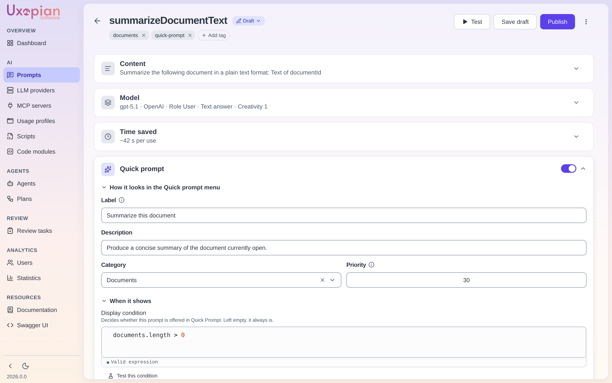

The prompts section of the admin panel lets you view, create, edit, and delete prompt definitions for the current tenant. Changes take effect immediately without restarting the application.

## Navigate to prompts

In the admin panel, click "Prompts" in the navigation. The page lists the prompts available for the current tenant, including globals and tenant-specific overrides. The list is paginated and filtered on the server: the search box and the filters (model, Quick prompt, tags) narrow the list, and columns can be sorted, resized, hidden and reordered (the layout is remembered). A prompt's **tags** are shown under its name and can be used as a filter (several tags match any of them). The **Used by** column names the usage profiles and agents that reference the prompt, with a dash for a prompt nothing uses.

Click a row to open a quick view, use the arrow keys to walk through the list, and double-click a row to open the prompt for editing.



*Figure: the Prompts list (screenshot taken before the 2026.0.0 redesign).*

## Create a prompt

1. Click "Create prompt".
2. Fill in the cards of the editor. Only the **Prompt name** and the **Content** are required:
   - **Prompt name**: unique identifier, used in request content items (`type: prompt`, `value: <id>`). A name already in use is reported while you type.
   - **Content**: Thymeleaf template text. Use `[[${variable}]]` for expressions.
   - **Model**: the role (`SYSTEM`, `USER`, or `ASSISTANT`), the LLM provider and model the prompt runs on, the temperature, and the capability switches (see below).
   - **Answer format**: an optional structured answer format.
   - **Time saved** and **Quick prompt**: optional, see below.
3. Click "Create prompt".

## Prompt detail page

Click on a prompt in the list to open it (route `/prompts/:promptId`). Every prompt is a **series of versions** with an explicit draft → publish lifecycle: a **published** version serves live traffic, an optional **draft** holds in-progress edits, and every previously published version is kept, browsable, and restorable.

The page is made of foldable cards — **Prompt name**, **Content**, **Model**, **Time saved**, **Quick prompt** — that show a one-line summary of their content when folded, so the whole prompt can be read at a glance. The editor always works on the **draft**: when no draft exists, it opens pre-filled with the published version's content, and nothing is saved until you act.

At the top of the page:

- A **version selector** (a badge showing the version you are on) lists every version in three groups: **In progress** (the draft), **Active** (the published version) and **Archived** (versions published before and then superseded). Choosing a version other than the draft opens it read-only, with its own usage figures.
- A **usage badge** tells whether other entities use the prompt, and an **Unsaved** badge appears while edits have not been saved as a draft.
- The **tags** of the prompt, which can be edited in place. Tags are not versioned: they belong to the prompt and are shared by all its versions.
- The action bar: **Test**, **Discard** (only when there are unsaved edits), **Save draft**, **Publish**, and a "..." menu with **Discard draft…** (only when a draft exists) and **Delete prompt…**.



*Figure: Prompt page — the cards edit the draft; the version selector opens other versions read-only.*

The actions of the editor:

- **Save draft** persists your edits as the draft (creates one on first save if none existed yet: `POST /api/v1/admin/prompts/{id}/versions`, then `PUT .../versions/{version}` on subsequent saves). The draft is never live; only publishing makes it so.
- **Publish** promotes the current draft to Active (`PUT .../versions/{version}` with `draft:false`) after a confirmation. The previously published version becomes an archived entry. A published version can never be edited directly: attempting to update a non-draft version is rejected with `409 Conflict`.
- **Discard** reverts unsaved edits in the editor to the last saved state, without calling the API.
- **Discard draft…** deletes the draft without publishing, keeping the published version untouched (`DELETE .../versions/{version}`).

:::tip[The point of a draft: try it for real before it goes live]
A draft isn't limited to the admin Test window — any caller can target it directly from a normal conversation request by setting the `version` field on a `type: prompt` content item (see [Conversations and requests](../understanding/conversations_and_requests.md#content-types)) to the draft's version number. That's what the draft → publish separation is actually for: validate the new wording against real conversations, real payloads, and real callers first, with zero risk to the currently published version, then **Publish** once you're satisfied.
:::

### Content card

A Thymeleaf template editor with auto-completion. The editor fetches completion metadata from `GET /api/v1/admin/templating/completion`, providing suggestions for available service helpers and variables, and keeps suggesting a path's fields while you type (`user.us`).

Since 2026.0.0-ft4, the editor also autocompletes the **context variables** available to [Quick Prompt](../understanding/quick_prompt.md) templates. Typing inside a `[[${ … }]]` expression suggests the root variables (`tenant`, `user`, `documents`, `tasks`, `folders`, `injected`, `capabilities`), their object properties after a dot (e.g. `${user.` → `username`, `roles`, …), and array-item attributes (e.g. `${documents[0].` → `title`, `properties`, `tags`, …). Each suggestion shows its type and a short description.

### Model card

| Setting | Description |
|---|---|
| Role | `SYSTEM`, `USER`, or `ASSISTANT` |
| LLM provider and model | The provider and model this prompt runs on. They take precedence over the [usage profile](./managing_applications.md#resolution-order)'s defaults; when the prompt names none, the usage profile's are used. There is no system-wide fallback |
| Temperature | Sampling temperature, a number between 0 and 2 (default 1). A value outside this range is refused when saving. The default was 0 before 2026.0.0, which made some reasoning models answer `400` |
| Can use tools | When off, no tool is offered to the model for this prompt (the `reasoningDisabled` flag, inverted) |
| Only on models that can use tools | The prompt refuses to run on a model that cannot call tools (`requiresFunctionCallingModel`) |
| Only on models that read images | The prompt refuses to run on a model that cannot read images and files (`requiresMultiModalModel`) |

### Answer format card

Leave it empty for a free-text answer. Otherwise the answer must follow a structure, and reaches the caller as JSON. Two syntaxes are available, chosen with a segmented control:

- a **simple notation**, such as `{ "answer": "string: the answer in one sentence", "sources": ["string"] }`: each field has a type (`string`, `number`, `integer` or `boolean`) optionally followed by `: description`, `{ }` makes an object and `[ ]` a list. It is converted to a strict JSON Schema in which every field is required;
- a **JSON Schema**.

Errors are shown on the field and Save is disabled while the format is invalid. This stores the `outputSchema` of the prompt version.

### Quick prompt card

Since 2026.0.0-ft4, this card controls whether and how the prompt appears in the [Quick Prompt](../understanding/quick_prompt.md) panel. A prompt is offered in Quick Prompt only when it is **enabled here** and its **display condition** matches the current context.



*Figure: the display settings of a prompt (screenshot taken before the 2026.0.0 redesign). The display-condition editor validates the expression and provides a test panel with a sample context.*

| Setting | Description |
|---|---|
| Enabled | Whether the prompt is offered in Quick Prompt |
| Label | Short title shown on the prompt card |
| Category | Free-form category used to group prompt cards. The selector suggests categories already in use across the tenant. |
| Priority | Ordering of prompt cards (lower numbers show up first in Quick Prompt) |
| Description | Markdown description shown to the user under the prompt card |
| Display condition | A JavaScript expression evaluated client-side against the current context; the prompt is shown only when it returns `true` |

Display conditions run in a restricted sandbox (no `eval`, no globals) and may use property access, comparisons, logical operators, and the helpers `includes`, `startsWith`, `endsWith`, `some`, `every`, and `find`. A condition that fails to parse or throws evaluates to `false`, hiding the prompt. For example:

```javascript
documents.length === 1 && documents[0].type === 'pdf'
user.roles.includes('REVIEWER')
```

The condition editor is a single card that expands whole. Conditions on data keys named like reserved properties (for example `properties.__type`) are read instead of silently evaluating to `false`.

End users only ever receive the display settings (label, category, priority, description, condition) — never the prompt's template content or LLM configuration.

### Test window

**Test** opens a window from the page header. It stays available while the form has unsaved edits: it runs a **saved** version, picked in its own version selector (the draft, the active version, or an archived one), and says so — **unsaved edits in the editor are not included**, and opening the window keeps them. Save the draft first to test your latest wording.

1. The tester auto-detects the variables of the template.
2. Fill in variable values. A value can be text or an uploaded image.
3. Click "Run" (or press Ctrl+Enter) to send the prompt to the configured LLM provider.
4. View the response, response time, and token usage.

A second version can be picked to **compare** the two answers side by side with the same values ("Run both"). The previous answer is cleared when the version or the content changes, and results are not kept when the window is closed.

The test calls the render endpoint, targeting the selected version number:

```
GET /api/v1/admin/prompts/{id}/render?version={version}
```

### Archived versions and restore

Selecting an **archived** version in the version selector shows its settings, content and its own **per-version statistics** (usage count, token cost, feedback) read-only. A **Restore as draft** button copies that version's content into the draft (`POST .../versions` with the old content); publish it afterwards to make it live. A confirmation dialog warns that this overwrites any existing draft. It does not resurrect the old version number: publishing creates a new one with the old content.

Each version carries who created it and when it was last updated; versions stored before 2026.0.0 only get these stamps on their next write.

### Statistics

Usage analytics **aggregated across every version** of the prompt (per-version figures are shown when you open a version instead):

| Metric | Description |
|---|---|
| Usage count | Total number of times the prompt was executed |
| Token cost | Aggregate tokens consumed |
| Average cost | Mean tokens per execution |
| Feedback distribution | Pie chart of user feedback (positive, negative, neutral) |
| Time saved | Cumulative time saved based on the estimation setting |

Fetched from `GET /api/v1/admin/prompts/{id}/statistics` (aggregate) or `GET /api/v1/admin/prompts/{id}/versions/{version}/statistics` (per version).

## Delete a prompt

In the "..." menu of the prompt page, click "Delete prompt…". A confirmation dialog is displayed. A prompt that is the base prompt, or that is referenced by a [usage profile](./managing_applications.md) as its system prompt or by an agent as its objective, cannot be deleted while referenced — the API returns `409 Conflict` naming the entities using it. Remove the reference first.

## REST API endpoints

| Method | Endpoint | Description |
|---|---|---|
| `GET` | `/api/v1/admin/prompts` | List the prompts of the current tenant (feeds the list page): a page `{ collection, total, facets }` of prompts with usage. Each item carries the active version and the draft, never the other versions. Filters: `search`, `model`, `quick`, `tag` (repeatable), `workspaceId` (repeatable); pagination: `offset`, `limit` (default 20), `orderBy`, `ascending` — `offset + limit` must stay at or under 10000 |
| `POST` | `/api/v1/admin/prompts` | Create a new prompt — its initial version, v0 (`201`; `409` if the ID already exists) |
| `GET` | `/api/v1/admin/prompts/availability?id={id}` | `true` when a new prompt can take this ID, `false` when it is taken or blank |
| `GET` | `/api/v1/admin/prompts/{id}` | Get the prompt detail: its active version, its draft, the summary of every version (version, draft flag, created/updated by and at), its tags and workspace |
| `GET` | `/api/v1/admin/prompts/{id}/versions/{version}` | Get one specific version, whole |
| `POST` | `/api/v1/admin/prompts/{id}/versions` | Create the draft (409 if a draft already exists) |
| `PUT` | `/api/v1/admin/prompts/{id}/versions/{version}` | Edit the draft, or publish it with `draft:false` (409 if the target isn't the draft — published versions are read-only) |
| `DELETE` | `/api/v1/admin/prompts/{id}/versions/{version}` | Discard the draft, keeping published versions intact (409 if not the draft) |
| `GET` | `/api/v1/admin/prompts/{id}/render` | Render the active version, or a specific one via `?version=`. The variable values go in an optional JSON body. |
| `GET` | `/api/v1/admin/prompts/{id}/statistics` | Usage statistics aggregated across every version |
| `GET` | `/api/v1/admin/prompts/{id}/versions/{version}/statistics` | Usage statistics for a single version |
| `GET` | `/api/v1/admin/prompts/{id}/usage` | Whether the prompt is deletable, and what uses it (`usedBy`: usage profiles and agents, typed like `usage-profile Support` or `agent reader`) — what drives the *Used by* column and the disabled Delete button |
| `PUT` | `/api/v1/admin/prompts/{id}/tags` | Replace the tags of the prompt (`404` if unknown) |
| `GET` | `/api/v1/admin/prompts/tags` | List the distinct tags currently in use (feeds the tag filter) |
| `DELETE` | `/api/v1/admin/prompts/{id}` | Delete the prompt and every version (`204`) |
| `GET` | `/api/v1/admin/prompts/categories` | List the distinct Quick Prompt categories currently in use (feeds the category selector) |
| `GET` | `/api/v1/admin/templating/completion` | Get auto-completion metadata for the template editor |

The former `GET /api/v1/admin/prompts/{id}/versions` and `GET /api/v1/admin/prompts/{id}/tags` routes no longer exist: read the versions and tags from `GET /api/v1/admin/prompts/{id}`. In `/usage`, the former `referencedBy` field (application names) is replaced by `usedBy`.

The Quick Prompt panel reads each prompt's display settings (never the template content) via the user-facing endpoint `GET /api/v1/prompts/display`.

## Related pages

- [Prompts and templating](../understanding/prompts_and_templating.md)
- [Write prompts](../extending/writing_prompts.md)
- [Configuration file reference (prompts.yml)](../reference/configuration.md#promptsyml)
- [Environment variables reference](../reference/environment_variables.md)
- [Admin panel overview](./admin_panel_overview.md)
