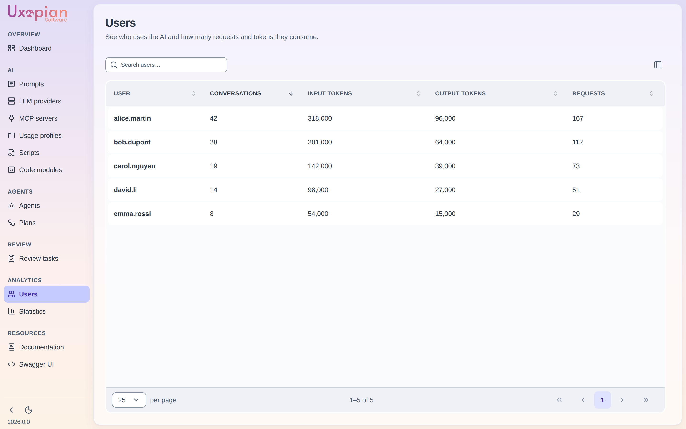
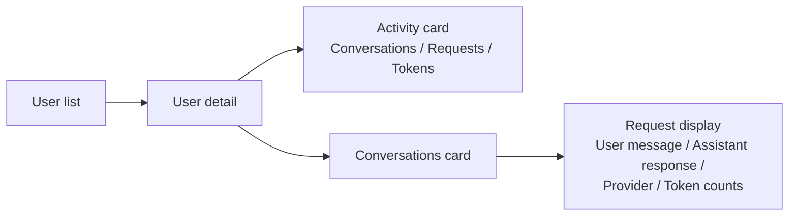

The users section of the admin panel provides a read-only view of all users for the current tenant. Administrators can browse user activity, view conversation history, and inspect individual LLM requests.

## User list

Navigate to "Users" in the admin panel. The table lists all users with sortable columns:

| Column | Description |
|---|---|
| User ID | Identifier passed in `X-User-Id` headers |
| Conversations | Total conversation count |
| Input tokens | Aggregate input token count |
| Output tokens | Aggregate output token count |
| Request count | Total number of LLM requests |

Use the search field at the top to filter users by ID. The list is paginated and sorted on the server: only one page of users is fetched at a time, and the columns can be sorted, resized and hidden.

Data is fetched from `GET /api/v1/admin/users/statistics`, which takes `search` (a term looked for in the user ID) and the pagination parameters `offset`, `limit` (default 20), `orderBy` and `ascending`, and answers a page `{ collection, total, facets }`. By default the users with the most conversations come first; `orderBy` accepts `userId`, `conversationCount`, `requestCount`, `inputToken` and `outputToken`.

*Figure: the Users list — per-user conversation count, input/output tokens, and request count, with sortable columns.*

Click a row — or double-click it — to open the user detail page.

## User detail page

Route: `/users/:userId`.

*Figure: User detail page layout.*

### User summary

An **Activity** card shows aggregate statistics for the selected user, with the date of the last activity:

| Stat | Description |
|---|---|
| Conversations | Number of conversations |
| Requests | Total LLM requests |
| Tokens | Total tokens, split into input and output |

A refresh button reloads the statistics.

Fetched from `GET /api/v1/admin/users/details?userId={userId}`.

### Conversation list

A **Conversations** card lists the user's conversations, loaded page by page (*Show more conversations*). Click a conversation to display its requests.

### Request display

For the selected conversation, the main panel shows each request in chronological order. Each request displays:

- The user message content
- The assistant response
- The LLM provider and model used
- Token counts (input and output)
- The tools the assistant used, in a collapsed *Tools used (n)* section, and the files the request references

Requests are paginated. Fetched from `GET /api/v1/admin/requests?conversation={conversationId}&offset={offset}&limit={limit}`. The list answers lightweight request summaries, without the context payload: fetch `GET /api/v1/admin/requests/{id}` for a request in full.

Token counts include every completion of the tool-calling loop of a request, so totals are higher than before 2026.0.0 for conversations that use tools.

## REST API endpoints

| Method | Endpoint | Description |
|---|---|---|
| `GET` | `/api/v1/admin/users/statistics` | List users with conversation stats (paginated, `search` filter) |
| `GET` | `/api/v1/admin/users/details?userId={id}` | Get the statistics of one user |
| `GET` | `/api/v1/admin/conversations` | List conversations (paginated; `userId` keeps one user's conversations, `workspaceId` filters by workspace) |
| `GET` | `/api/v1/admin/conversations/{id}` | Get a conversation by ID |
| `DELETE` | `/api/v1/admin/conversations/{id}` | Delete a conversation |
| `GET` | `/api/v1/admin/requests?conversation={id}&offset={n}&limit={n}` | Paginated request summaries for a conversation |
| `GET` | `/api/v1/admin/requests/{id}` | Get a specific request |
| `DELETE` | `/api/v1/admin/requests/{id}` | Delete a request |

## Related pages

- [Conversations and requests](../understanding/conversations_and_requests.md)
- [Admin panel overview](./admin_panel_overview.md)
- [Monitoring statistics](./monitoring_statistics.md)
