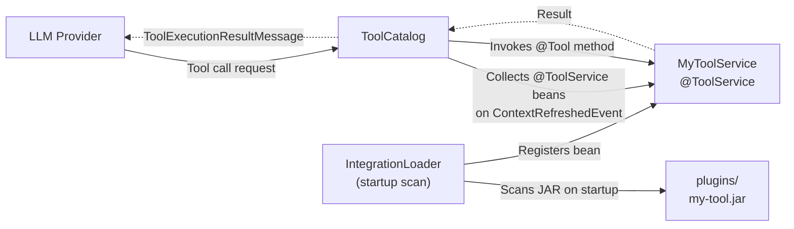

A custom tool is a Java method that the LLM can call during a conversation. Tools give the LLM the ability to perform actions: query a database, call an external API, read a file. This guide explains how to write a tool, package it, and deploy it.

:::tip No Java needed for small tools
If the tool is a short computation or a data transformation, you can write it in JavaScript from the admin console instead, with no build and no restart. See [Code modules](../how_to/code_modules.md).
:::

## How a custom tool fits in the system



*Figure: A custom tool JAR is scanned at startup, registered by IntegrationLoader, and invoked through ToolCatalog on LLM tool call requests.*

## Prerequisites

- Java 21 or later (the plugin JAR must target Java 21 bytecode)
- Maven with access to the Uxopian AI BOM or individual dependency coordinates
- The uxopian-ai `model` and `common` modules available as dependencies (or use the shaded JAR approach)

## Steps

### 1. Create a Maven project

Create a standard Maven project. Add the required dependencies: the LangChain4J `agent.tool` annotations and the uxopian-ai tool annotations. The key annotations come from:

- `dev.langchain4j:langchain4j-core`: provides `@Tool` and `@P`
- `com.uxopian.ai:integration-api`: provides `@ToolService`, `@HelperService`, `ToolInstruction` and the types a plugin may depend on (groupId `com.uxopian.ai`, artifactId `integration-api`)

```xml
<dependency>
    <groupId>dev.langchain4j</groupId>
    <artifactId>langchain4j-core</artifactId>
    <version>1.11.0</version>
</dependency>
<dependency>
    <groupId>com.uxopian.ai</groupId>
    <artifactId>integration-api</artifactId>
    <version>${uxopian-ai.version}</version>
</dependency>
```

The `integration-api` artifact (named `annotation` before 2026.0.0) is published to the Arondor Artifactory registry (`artifactory.arondor.cloud`). See [Registry access](../getting_started/registry_access.md) for repository configuration. Set `${uxopian-ai.version}` to the Uxopian AI release version you are targeting.

### 2. Write the tool class

```java
import dev.langchain4j.agent.tool.P;
import dev.langchain4j.agent.tool.Tool;
import com.uxopian.ai.model.annotation.tool.ToolService;
import org.springframework.stereotype.Service;

@Service
@ToolService
public class MyCustomTool {

    @Tool("Search the internal knowledge base for articles matching a topic. "
        + "Returns a list of article titles and summaries.")
    public List<String> searchKnowledgeBase(
            @P("The topic to search for") String topic,
            @P("Maximum number of results") int maxResults) {

        // Your implementation here
        return List.of("Article about " + topic);
    }
}
```

Rules for tool methods:
- The method must be `public`.
- The `@Tool` annotation value is the description sent to the LLM. Write it clearly: the LLM uses this description to decide when to call the tool.
- Each parameter annotated with `@P` gets a description. The LLM uses these to construct the arguments.
- The return type must be serializable. Strings and lists of simple objects work well. The result is converted to a string before being returned to the LLM.
- Tool execution is synchronous. Long-running operations will block the request thread.

### 3. Package as a shaded JAR

The plugin JAR must be self-contained (all dependencies included). Use the Maven Shade plugin:

```xml
<plugin>
    <groupId>org.apache.maven.plugins</groupId>
    <artifactId>maven-shade-plugin</artifactId>
    <version>3.5.0</version>
    <executions>
        <execution>
            <phase>package</phase>
            <goals>
                <goal>shade</goal>
            </goals>
        </execution>
    </executions>
</plugin>
```

Build the shaded JAR:

```bash
mvn clean package
```

The output JAR is in `target/my-custom-tool-1.0.0.jar` (or similar).

### 4. Deploy the JAR

Copy the shaded JAR to the `plugins/` directory on the uxopian-ai host. In Docker Compose deployments, mount the directory:

```yaml
services:
  uxopian-ai:
    volumes:
      - ./plugins:/app/plugins
```

Then copy the JAR:

```bash
cp target/my-custom-tool-1.0.0.jar ./plugins/
```

### 5. Restart uxopian-ai

Plugins are scanned at startup. Restart the container to load the new plugin:

```bash
docker compose restart uxopian-ai
```

Check the logs to confirm the tool was registered:

```bash
docker compose logs uxopian-ai | grep "Registered"
```

You should see a line indicating the number of tool methods registered.

### 6. Verify the tool is available

The LLM will use tools when they are relevant to the user's request. To confirm the tool is loaded, check the admin UI statistics or send a request that explicitly asks the LLM to use the tool.

## Guide the model with instructions

Some rules cannot be expressed in a tool description alone: "call this tool at most once", "wrap the filter in a clause". `@ToolService` accepts an `instructions` attribute listing `ToolInstruction` classes. Each instruction has a short upper-case marker that the tool descriptions refer to, and a text (1,500 characters at most) that must mention that marker in square brackets.

```java
public class CallOnceInstruction extends ToolInstruction
{
    public CallOnceInstruction()
    {
        super("CALL_ONCE",
                "Tools marked [CALL_ONCE] must be called at most once per workflow.");
    }
}

@Service
@ToolService(tags = "knowledge", instructions = CallOnceInstruction.class)
public class MyCustomTool
{
    @Tool("[CALL_ONCE] Search the internal knowledge base.")
    public List<String> searchKnowledgeBase(@P("The topic to search for") String topic) { /* ... */ }
}
```

For a call, Uxopian AI collects the instructions of the tools that call is allowed to use, removes duplicates, sorts them and adds them once to the conversation system message. Nothing is sent for a tool family the usage profile does not allow.

You can also define your own annotation and mark it with `@ToolDescriptorFragment(text = "...", instructions = ...)`: its text is prepended or appended to the `@Tool` description of every method that carries it. The built-in marks of the product tools (`CALL_ONCE`, `TEXT_CONTENT`, `METADATA_ONLY` and others) work this way, but those annotations live in an internal module: a plugin defines its own.

### Confirm destructive actions

The built-in `@DestructiveAction` annotation, used by the product's own tools, gives a method a description that tells the model to ask for confirmation first. The model must call the `presentChoices` tool with a `confirm` and a `cancel` option (a question written as plain text renders no button), and call the method only after the user has confirmed. This is carried by the description, so it is probabilistic and not a server-side guard. A plugin that needs the same behaviour writes its own `@ToolDescriptorFragment` annotation.

## What a plugin can depend on

`integration-api` is the artifact published to integrators. It deliberately has almost no dependencies (`jackson-annotations`; Swagger annotations and SLF4J are optional) and brings in no Spring. It contains:

- the annotations `@ToolService`, `@HelperService`, `ToolInstruction` and `ToolDescriptorFragment`;
- `AiContext`, the immutable context of the current call, with `AuthenticatedUser` (id, tenant, roles, locale, provider and usage profile; its `toString` never prints the token) and the identifiers in `com.uxopian.ai.model.id`;
- `ClientActionDispatcher`, to send a command to the user's browser with `sendCommandToClient(sessionId, command)`. The call is best effort and returns `false` when the command could not be delivered.

Plugins compiled against 2026.0.0-ft5 must be recompiled: classes moved packages, `HostActionDispatcher` became `ClientActionDispatcher`, `AuthenticatedUser` and `AiContext` lost their setters (use the `with...` copies), and `AuthenticatedUser.isAdmin()` was removed because the product has no role-based authorization.

## Important constraints

- Shaded JARs must not include Spring Boot's own classes. Only include classes needed by the tool.
- If a bean name collides with an already-registered bean, `IntegrationLoader` logs a warning and skips the duplicate.
- Tools can be disabled globally with `TOOLS_ENABLED=false`.
- The LLM only calls tools if the model configured for the conversation has `functionCallSupported: true`.
- Prompts with `reasoningDisabled: true` do not receive tool specifications.
- A conversation only gets the tools its usage profile allows. A call that resolves no usage profile permissions gets no tool at all, native, MCP and sub-plan tools included, so define the permissions on the usage profile.
- When two tools share a name, resolution order is MCP, then native `@Tool`, then plan exposed as a tool, then code module. Pick a unique name.

## Related pages

- [Tools](../understanding/tools.md)
- [Plugin system](../understanding/plugin_system.md)
- [Code modules](../how_to/code_modules.md)
- [Write custom service helpers](./custom_service_helpers.md)
- [LLM providers](../understanding/llm_providers.md)
