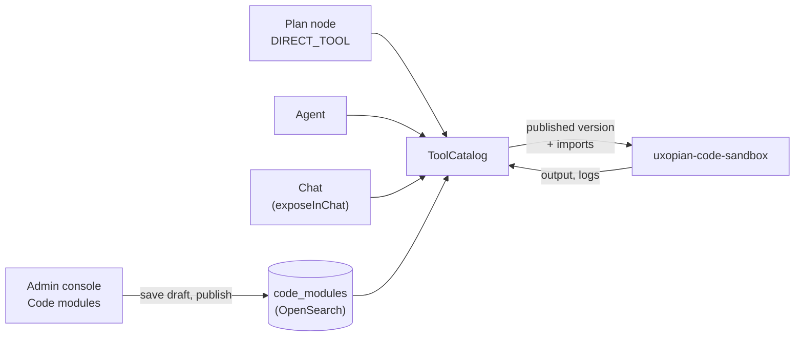

A code module is a piece of JavaScript that you write and publish from the admin console, with no build and no restart. A module can be a small library that other modules import, and it can also be a tool: a function that a plan, an agent or a chat conversation calls. The code runs in a separate service, **uxopian-code-sandbox**, in an isolated engine with no filesystem, no threads and no direct network access.

Use a code module for what is too small to justify a Java plugin: reformat a value, compute a total, check an identifier, call an allowed HTTP API. For anything that needs the full Java ecosystem, write a [custom tool](../extending/custom_tools.md) instead.



*Figure: Only the published version of a module runs. The tool catalog sends the module and the modules it imports to the sandbox.*

## Prerequisites

- A running Uxopian AI stack with OpenSearch.
- A running uxopian-code-sandbox reachable from uxopian-ai, and its shared secret.
- Admin access to the admin console.

## Connect uxopian-ai to the sandbox

Execution needs the sandbox. Without it the feature is off: modules can still be edited, but they cannot run and no code tool is offered to the LLM.

| Property | Default | Description |
|---|---|---|
| `code-sandbox.url` | _(empty)_ | Base URL of the sandbox. Empty or unset turns the feature off |
| `code-sandbox.secret` | _(empty)_ | Secret shared with the sandbox |
| `code-sandbox.caller-name` | `uxopian-ai` | Name uxopian-ai presents to the sandbox |
| `code-sandbox.capability-profile` | `uxoai` | Capability profile the sandbox applies to the code |
| `code-sandbox.max-active-sessions` | `16` | Most executions running at the same time. One more fails immediately with a "try again later" error |

The properties are bound by Spring, so they can be set as environment variables (`CODESANDBOX_URL`, `CODESANDBOX_SECRET`, and so on) as well as in `application.yml`.

The sandbox decides what a module may reach. The domains a module may call over HTTP are listed in the sandbox's own configuration, not on the module: there is no "allowed domains" field in the admin console, and values stored by an earlier build are ignored.

## Create a module

1. Open **Code modules** in the admin console and click **Create**.
2. Give the module a **Name**. The name is its identifier, and it is checked as you type:
   - it must be a JavaScript identifier of 1 to 64 characters (letters, digits and `_`, not starting with a digit), not a reserved word, and it cannot contain `$`;
   - it must not collide with a native tool, an MCP tool, a plan exposed as a tool or another module. The same name is the object other modules import, the module name in the sandbox and the tool name the LLM calls.
3. Fill **What it does**. The description is required (2,000 characters at most). For a tool, it is what the LLM reads to decide when to call it.
4. Write the **Source**.
5. Click **Save draft**.

A new module exists only as a draft until you publish it.

### Write the source

A module exports a function `run` that receives the tool arguments as `input`:

```javascript
exports.run = function (input) {
  log('counting the lines of ' + input.text.length + ' characters');
  return input.text.split('\n').length + ' lines';
};
```

| Available to the code | Description |
|---|---|
| `input` | The arguments of the call, as an object |
| `log(value)` | Writes to the service log at INFO level and to the tool-call trace (`logs`, 50 lines of 500 characters at most), which the plan run detail shows |
| `ai.context()` | Returns the user (id, roles, locale), the tenant, the provider, the usage profile, the conversation, the request and the plan run that triggered the call. It never returns the user's token |

A code module cannot call other tools. What it returns becomes the tool result: the output of a `DIRECT_TOOL` node, or the text the LLM reads.

Limits checked when you save: 256 Ki characters of code, 20 tags, 30 parameters, 20 imports. A module cannot import itself, and an import cycle is refused.

### Import other modules

List published modules in **Modules it imports**. What an imported module assigns to `exports` is in scope under its name, dependencies first.

```javascript
// module "dates"
exports.year = function (d) { return d.slice(0, 4); };

// module "report", which imports "dates"
exports.run = function (input) {
  return 'Report ' + dates.year(input.day);
};
```

Only **published** modules can be imported, and an importer always gets the published version of its dependencies.

## Make a module a tool

Switch on **Call it as a tool** to add the tool section:

| Field | Description |
|---|---|
| Parameters | The arguments `run` receives as `input`: a name, a description the LLM reads, and whether it is required. Names are unique |
| Timeout (ms) | Execution budget, between 100 and 10,000. Default 3,000. The sandbox clamps it |
| Callable in chat | When on, conversations can call the tool. Plans and agents can call it either way |
| Tags | Free tags. Tool permissions can allow tools by tag. Every code tool also carries the tag `code` |

A code tool is called from:

- a **`DIRECT_TOOL` plan node**, by naming the module as `toolName`: no LLM is in the loop, the step is cheap and deterministic. See [Agentic plans](../understanding/agentic_plans.md);
- an **agent**, when the module is in its allowed tools;
- the **chat**, when **Callable in chat** is on, and only within the tool permissions of the usage profile (allowed tools and tags).

A call that resolves no tool permissions gets no tool at all. Define the permissions on a usage profile.

If two tools share a name, resolution order is MCP, then native `@Tool`, then plan exposed as a tool, then code module. The admin console checks the name live for conflicts.

The tool catalog `GET /api/v1/admin/tools` lists code tools beside the others, and each entry carries a call type, `LOCAL` for a Java tool or `CODE` for a code module.

## Test a module

Click **Test** in the page header. A window opens with the input as JSON and a **Result** area. It runs the module as it currently stands in the editor, including an unpublished draft, by calling `run(input)` in the sandbox. Press Ctrl+Enter to run. The result shows the output or the error, the logs and the time taken. Results are not kept when you close the window.

The same check is available over REST with `POST /api/v1/admin/code-modules/test`.

## Publish

**Publish** makes the draft the version everything runs. Before it accepts, uxopian-ai checks with the sandbox that the module and every module that imports it still work, and refuses the publication, naming the module that would fail.

The **Published version** card shows the status, who published and when (`publishedAt`, `publishedBy`), the imports, and a toggle to show the published code.

Behind the **...** menu:

- **Discard draft** drops the draft code and imports and returns to the published version. It is refused when there is no draft, and when the module was never published (delete it instead).
- **Duplicate** starts a new module from this one.
- **Delete code module** is refused while another module imports it, while a plan calls it through a `DIRECT_TOOL` node, or while an agent is allowed to use it. The **Used by** list names them.

The list page shows each module's state: `PUBLISHED`, `DRAFT` (published with a pending draft) or `UNPUBLISHED`. It supports search, state, role (tool or not) and used-by filters, server side.

## Manage modules over the API

Everything is under `/api/v1/admin/code-modules`:

| Method and path | Description |
|---|---|
| `GET /` | A page of summaries (`{ "collection": [...], "total": n, "facets": {...} }`), without code. Filters `search`, `state`, `tool`, `usedBy`, plus `offset`, `limit`, `orderBy` (`id`, `description`, `role`, `state`) and `ascending` |
| `GET /availability?id=<id>` | `true` when the id is free and usable |
| `GET /{id}` | The whole module |
| `POST /` | Create a module as a draft. The body carries `id`, `description`, `draftContent`, optional `draftImports` and `tool` |
| `PUT /{id}` | Change the description, the tool section and the draft |
| `POST /{id}/publish` | Publish the draft. `409` when there is nothing to publish |
| `DELETE /{id}/draft` | Discard the draft. `409` when there is none or the module was never published |
| `DELETE /{id}` | Delete. `409` while the module is used |
| `GET /{id}/usage` | The modules, plans and agents that use it |
| `POST /test` | Run a module and an input without saving |

Create and publish a tool in two calls:

```bash
curl -X POST https://your-gateway/api/v1/admin/code-modules \
  -H "Content-Type: application/json" \
  -d '{
    "id": "countLines",
    "description": "Counts the lines of a text",
    "draftContent": "exports.run = function (input) { return input.text.split(\"\\n\").length; };",
    "tool": {
      "inputParameters": [
        { "name": "text", "description": "The text to count", "required": true }
      ],
      "timeoutMillis": 3000,
      "exposeInChat": true,
      "tags": ["text"]
    }
  }'

curl -X POST https://your-gateway/api/v1/admin/code-modules/countLines/publish
```

## Upgrade note

If a `code_modules` index already exists from an earlier build, map the two publication fields once, because nothing completes the mapping at startup:

```bash
curl -X PUT "$OPENSEARCH/code_modules*/_mapping" -H 'Content-Type: application/json' \
  -d '{"properties":{"publishedAt":{"type":"date"},"publishedBy":{"type":"keyword"}}}'
```

A module published before keeps falling back on its last update date.

## Verification

1. Create a module `echo` with the source `exports.run = function (input) { return input; };`, then publish it.
2. Open **Test**, enter `{"hello": "world"}` and run. The result is the same object.
3. Turn on **Call it as a tool** and **Callable in chat**, save and publish. Allow the tool on a usage profile, then ask the chat to use it.

If the **Test** window answers that the module cannot run because `code-sandbox.url` is not configured, the sandbox is not connected.

## Related pages

- [Write and deploy custom tools](../extending/custom_tools.md)
- [Agentic plans](../understanding/agentic_plans.md)
- [Tools](../understanding/tools.md)
- [Managing plans](../admin/managing_plans.md)
- [Install on Kubernetes](../installation/kubernetes.mdx)
