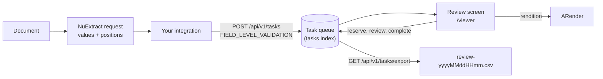

When a model extracts fields from a document (an invoice number, a supplier, a total), a person can check each value against the document before the result is used. Uxopian AI provides the pieces for this: a **task queue** (`/api/v1/tasks`), a **review screen** (the `viewer-element` web component) that shows the document next to the extracted values, and a **CSV export** of the decisions.



*Figure: An integration puts extraction results in the queue. A reviewer takes a task, decides on each value, and the decisions are exported.*

## Prerequisites

- A running Uxopian AI stack.
- ARender reachable from uxopian-ai, with `RENDITION_BASE_URL` set. The review screen draws one box per value on the document through ARender's JavaScript API. The ARender line must support annotation refresh (the compose demo stack uses ARender 2026.2.0 by default).
- Gateway routes that let the review traffic through, see [Gateway routes](#gateway-routes).
- To extract with NuExtract: a configured `nu-extract` provider, see [NuExtract document extraction](./configure_llm_providers.md#nuextract-document-extraction).

## Open the review screen

The screen is served by uxopian-ai at `<app>/viewer`. In the admin console, the **Review** entry of the navigation opens it in a new tab. It reuses the admin theme and the same authentication as the rest of the application.

Add `?mock=true` to open it on a built-in mock queue, which is useful to try the screen without any data.

### Embed it in your own page

The screen is a web component. Load the bundle and the style from the gateway, then add the element:

```html
<link rel="stylesheet" href="https://your-gateway/api/web-components/viewer/style">
<script src="https://your-gateway/api/web-components/viewer/script"></script>

<viewer-element endpoint="https://your-gateway"></viewer-element>
```

| Attribute | Description |
|---|---|
| `endpoint` | Gateway origin as reachable from the browser. The component appends `/api/v1` and reaches ARender through the `/rendition/` relay under the same origin |
| `mock` | `true` serves a mock queue instead of calling the API |

`window.createViewer({ endpoint, mock, target })` creates the element for you; `target` is a DOM element or a selector.

The admin and viewer pages send a strict `Content-Security-Policy` (`default-src 'self'`, no inline script, `frame-ancestors 'none'`) and `X-Frame-Options: DENY`. They cannot be framed in an `iframe`: embed the web component instead.

## Review a document

The screen has two views.

**The queue** lists tasks: the document, a status (`PENDING`, `OK`, `KO`), how many values are pending, accepted or corrected, and when the task was last touched. It supports server-side search (document name, document id, tags, an extracted value), sorting, paging and a **Filters** popover (status and tags, each with the number of tasks it would keep). Oldest tasks come first by default. Status tiles show what is waiting.

**The review view** shows the document with the evidence of the selected value outlined on the page, and the extracted values with their confidence. For each value the reviewer can:

- **validate** it: it becomes `OK`;
- **refuse** it and type the right one: it becomes `KO` and the correction must differ from the extracted value;
- **put it back** to the extracted value (`PENDING`).

Opening a task **reserves** it for the reviewer, so nobody else works on it. The reservation lapses after `task.reservation-seconds` (900 by default) and a lapsed reservation reads as free. Handing the task back releases it. Every value must be decided before the task can be submitted. The task completes as `OK` when no value was refused, and as `KO` when at least one was.

| Keys | Action |
|---|---|
| `j` or Down, `k` or Up | Next or previous value |
| `Home`, `End` | First or last value |
| `v`, `a` or `Enter` | Validate the value in focus |
| `r` or `c` | Refuse it and type the right value |
| `u` | Put it back to the extracted value |
| `Ctrl+A` | Validate every value still pending |
| `Ctrl+Enter` | Submit and take the next task |
| `Ctrl+Shift+Enter` | Submit and return to the queue |
| `Esc` | Hand the task back |
| `?` | Show or hide this list |

A value that has no confidence score shows no confidence bar.

## Export the decisions

**Export** in the queue downloads a CSV of the tasks the current filters keep, named `review-yyyyMMddHHmm.csv`. The file streams every match, with no row ceiling, and the `X-Task-Count` response header tells how many tasks it holds. There is one line per extracted value:

`task_id`, `task_status`, `task_tags`, `document`, `connector`, `created_at`, `created_by`, `reviewed_at`, `reviewed_by`, `value_id`, `value_tags`, `extracted_value`, `review_status`, `correction`, `confidence`, `model`, `page`

Cells that begin with `=`, `+`, `-`, `@`, a tab or a carriage return are prefixed with a quote, so a spreadsheet does not run them as a formula.

## Put work in the queue

A task holds a `type` and a payload in the format that type names. The only payload type today is `FIELD_LEVEL_VALIDATION`: a document and the values read from it.

```bash
curl -X POST https://your-gateway/api/v1/tasks \
  -H "Content-Type: application/json" \
  -d '{
    "tags": ["invoices"],
    "payload": {
      "type": "FIELD_LEVEL_VALIDATION",
      "document": {
        "id": "doc-facture-2026",
        "filename": "facture-FA-2026-0142.pdf",
        "mimeType": "application/pdf",
        "pageCount": 2,
        "reference": { "connector": "filesystem", "path": "invoices/facture-FA-2026-0142.pdf" }
      },
      "extractionItems": [
        {
          "id": "supplier",
          "tags": ["supplier"],
          "result": "Arondor SAS",
          "reviewStatus": "PENDING",
          "confidence": 0.94,
          "provenance": { "modelId": "nuextract", "date": "2026-10-20T10:00:00Z" },
          "evidences": [
            {
              "pageNumber": 0,
              "type": "DocumentRegion",
              "position": { "x": 0.1, "y": 0.1, "width": 0.3, "height": 0.05, "unit": "PAGE_FRACTION" }
            }
          ]
        }
      ]
    }
  }'
```

| Field | Description |
|---|---|
| `document.reference` | Where the file is, see [File references](#file-references) |
| `extractionItems[].id` | Stable identifier within the payload |
| `extractionItems[].result` | What was read. `userInput` holds the correction once a reviewer refused it |
| `extractionItems[].reviewStatus` | `PENDING`, `OK` or `KO` |
| `extractionItems[].confidence` | Between 0 and 1, optional |
| `evidences[].pageNumber` | Zero-based page |
| `evidences[].position` | `x`, `y`, `width`, `height` from the top left corner. `unit` is `POINTS` (default) or `PAGE_FRACTION` |

The payload is stored as given, at most `task.max-payload-bytes` bytes (262144 by default, `413` above). An unknown payload `type` is refused.

### Extract with NuExtract

A NuExtract answer carries `result` and `localization`, with positions as fractions of the page. Map them to extraction items and set `unit` to `PAGE_FRACTION`, which is why NuExtract and the review screen fit together:

1. Send the document to a `nu-extract` model with `POST /api/v1/requests` (not the streaming endpoint, which is refused with `422`).
2. Read `result` for the values and `localization` for where each value sits.
3. Create one task per document with `POST /api/v1/tasks`.
4. Reviewers work the queue, then you export the CSV or read the tasks back with `GET /api/v1/tasks/{id}`.

### File references

A document is named by an object whose `connector` field says which connector reads it:

| `connector` | Fields |
|---|---|
| `filesystem` | `path`, relative to the tenant folder |
| `flowerdocs` | `documentId`, optional `fileId` and `version` |
| `filenet` | `objectId`, optional `className` |
| `alfresco` | `nodeId` |
| `request` | `part`, `name`, `mimeType`, `size`, `persist` (a file sent with a request) |

When a reviewer opens a task, the server reads the file through its connector **as the reviewer**, uploads it to ARender, and the screen displays the rendition. The reviewer cannot name another file. FlowerDocs documents are read with the reviewer's own token, so FlowerDocs rights apply; a refusal comes back as `401`. A task whose connector is unknown still lists, with its document shown as unavailable.

The filesystem connector exists only when `file-connector.filesystem.root` is set. See [Install on Kubernetes](../installation/kubernetes.mdx#mount-a-document-folder-optional) and [Docker Compose](../installation/docker.md#optional-services-and-folders).

## The task API

All routes are user routes, scoped to the tenant. The caller identity is the holder of a reservation.

| Method and path | Description |
|---|---|
| `GET /api/v1/tasks` | A page of task summaries. Filters `status` (repeatable), `type`, `tag` (all tags must match), `search`. `orderBy` is `document`, `status`, `touched` or `created`, with `offset`, `limit`, `ascending` |
| `GET /api/v1/tasks/filter-counts` | Status and tag counts, each ignoring its own filter |
| `GET /api/v1/tasks/export` | The CSV |
| `POST /api/v1/tasks` | Create a task. `201`, or `413` when the payload is too large |
| `GET /api/v1/tasks/{id}` | The whole task. `404` if unknown |
| `POST /api/v1/tasks/{id}/reserve` | Take the task, or extend your reservation. `409` when someone else holds it or it is done |
| `POST /api/v1/tasks/{id}/release` | Give it back. `409` when you do not hold it |
| `PUT /api/v1/tasks/{id}/payload` | Replace the whole payload. You must hold the reservation |
| `POST /api/v1/tasks/{id}/complete` | Body `{"status": "OK"}` or `{"status": "KO"}`. You must hold the reservation |
| `POST /api/v1/tasks/{id}/rendition` | Upload the task's document to ARender and answer the rendition id |

A task is `{ id, type, status, tags, payload, reservation }`, with `reservation` holding `reservedBy`, `reservedAt` and `expiresAt` (epoch milliseconds).

## Gateway routes

Besides the usual routes, the gateway must let these paths through to uxopian-ai (behind its authentication):

- `/api/v1/tasks/**`
- `/viewer/**`
- `/rendition/**`
- `/api/web-components/viewer/**`

The screen finds its API under any prefix, for example `/gui/gateway/uxopian-ai/viewer`. See [Configure gateway routes](./configure_gateway_routes.md).

### The rendition relay

uxopian-ai proxies ARender at `<app>/rendition/` to `rendition.base-url` (`RENDITION_BASE_URL`), under the same gateway authentication. It forwards content headers only: no cookie, token or identity header reaches ARender. The answer is `404` when no base URL is set and `502` when ARender cannot be reached. The browser therefore never needs to reach ARender, and ARender does not call uxopian-ai back for the file.

## Configuration

| Property | Default | Description |
|---|---|---|
| `task.reservation-seconds` | `900` | How long a reservation lasts |
| `task.max-payload-bytes` | `262144` | Largest task payload accepted |
| `rendition.base-url` | _(empty)_ | ARender service. Also feeds the `/rendition/` relay |
| `file-connector.filesystem.root` | _(empty)_ | Root folder of the filesystem connector. Unset = connector absent |
| `file-connector.filesystem.allowed-extensions` | `pdf,png,jpg,jpeg,tif,tiff` | Accepted file extensions |

The tasks live in a new OpenSearch index, `tasks`, created with the tenant. An index created by an earlier build does not get new fields by itself: add any field with a manual mapping.

## Verification

1. Open `<app>/viewer?mock=true`. The mock queue appears; open a task and press `?` to list the shortcuts.
2. Without `mock`, create a task with the `curl` call above, using a file that exists under the filesystem root. It appears in the queue as `PENDING`.
3. Open it. The document renders with the value outlined. If the page stays empty, check `RENDITION_BASE_URL` and the `/rendition/` route (`404` or `502`).
4. Validate the value, submit, then call `GET /api/v1/tasks/export` and check the line.

## Related pages

- [Configure LLM providers](./configure_llm_providers.md)
- [Configure gateway routes](./configure_gateway_routes.md)
- [Integrate with ARender](./integrate_with_arender.mdx)
- [Web components](../understanding/web_components.md)
- [REST API reference](../reference/rest_api.md)
