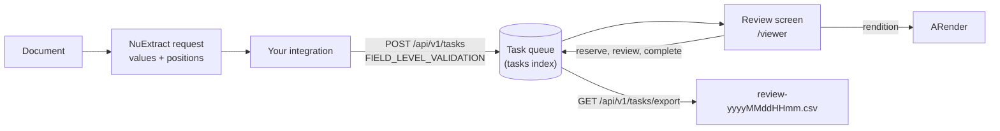

When a model extracts fields from a document (an invoice number, a supplier, a total), a person can check each value against the document before the result is used. Uxopian AI provides the pieces for this: a **task queue** (`/api/v1/tasks`), a **review screen** (the `viewer-element` web component) that shows the document next to the extracted values, and a **CSV export** of the decisions.



*Figure: An integration puts extraction results in the queue. A reviewer takes a task, decides on each value, and the decisions are exported.*

## Prerequisites

- A running Uxopian AI stack.
- ARender reachable from uxopian-ai, with `RENDITION_BASE_URL` set. The review screen draws one box per value on the document through ARender's JavaScript API. The ARender line must support annotation refresh (the compose demo stack uses ARender 2026.2.0 by default).
- Gateway routes that let the review traffic through, see [Gateway routes](#gateway-routes).
- To extract with NuExtract: a configured `nu-extract` provider, see [NuExtract document extraction](./configure_llm_providers.md#nuextract-document-extraction).

## Open the review screen

The screen is served by uxopian-ai at `<app>/viewer`. In the admin console, the **Review** entry of the navigation opens it in a new tab. It reuses the admin theme and the same authentication as the rest of the application.

Add `?mock=true` to open it on a built-in mock queue, which is useful to try the screen without any data.

### Embed it in your own page

The screen is a web component. Load the bundle and the style from the gateway, then add the element:

```html
<link rel="stylesheet" href="https://your-gateway/api/web-components/viewer/style">
<script src="https://your-gateway/api/web-components/viewer/script"></script>

<viewer-element endpoint="https://your-gateway"></viewer-element>
```

| Attribute | Description |
|---|---|
| `endpoint` | Gateway origin as reachable from the browser. The component appends `/api/v1` and reaches ARender through the `/rendition/` relay under the same origin |
| `mock` | `true` serves a mock queue instead of calling the API |

`window.createViewer({ endpoint, mock, target })` creates the element for you; `target` is a DOM element or a selector.

The admin and viewer pages send a strict `Content-Security-Policy` (`default-src 'self'`, no inline script, `frame-ancestors 'none'`) and `X-Frame-Options: DENY`. They cannot be framed in an `iframe`: embed the web component instead.

## Review a document

The screen has two views.

**The queue** lists tasks: the document, its status, how many values are pending, accepted or corrected, when the task was **created** and when it was **last modified** (date and reviewer, `—` when nobody decided anything yet). A task is in one of four statuses: **Awaiting review**, **Being reviewed** (someone holds it), **Accepted** and **Corrected**. The queue opens on *Awaiting review*, oldest task first.

- **Search** looks in the document name and id, the tags and the extracted or corrected values. It ignores case and accents.
- **Filters** keeps tasks by status and by tag, each choice showing how many tasks it would keep. Tags combine with *or*: a task carrying any checked tag is kept. **Reset** goes back to the opening filters and keeps the search text. Every active filter shows as a chip under the search box, which removes it.
- **Dates** keeps the tasks **created** or **reviewed** between two days, or two times of day. A *To* day runs to 23:59. Filtering on the review date leaves out the tasks not reviewed yet.
- When a search finds nothing under the current filters but matches tasks in other statuses, the queue says so and offers **Show N tasks**.
- **Review next** takes the first free task under the current filters and sort, asking the server, and says so when none is waiting.
- Created, Last modified, Status and Document are sortable. Status sorts in the order Awaiting review, Being reviewed, Accepted, Corrected.

**The review view** shows the document with the evidence of the selected value outlined on the page, and the extracted values with their confidence. A value whose id is a field path is captioned with its field, for example `assure · date_naissance`, and the cells of one table row are grouped under that row (`biens_endommages · row 1 · valeur_declaree`). A value shows its page only when it was located. For each value the reviewer can:

- **accept** it: it becomes `OK`;
- **reject** it and type the right one: it becomes `KO`. The correction must differ from the extracted value. An empty correction clears the value, and an empty value (unread, or cleared) shows an **Empty** badge and can be filled in. Soft hyphens, zero-width characters, non-breaking spaces and ligatures that a PDF hides in a pasted text are cleaned up;
- **put it back** to the extracted value (`PENDING`).

**Accept all** accepts every pending value of the task, including those a tag filter hides. **Undo all** puts every decided value back to pending, and asks for confirmation when it would lose a typed correction. Every icon-only button has a tooltip.

Opening a task **reserves** it for the reviewer, so nobody else works on it. The reservation lapses after `task.reservation-seconds` (900 by default) and a lapsed reservation reads as free. Leaving the task, with the back arrow, the browser Back button or **Hand back**, releases it; the decisions already saved stay. Every value must be decided before the task can be submitted. The task completes as `OK` when no value was refused, and as `KO` when at least one was. A reviewed or archived task, or a task someone else holds, opens read only, with who reviewed it and when.

| Keys | Action |
|---|---|
| `j` or Down, `k` or Up | Next or previous value |
| `Home`, `End` | First or last value |
| `v`, `a` or `Enter` | Accept the value in focus |
| `r` or `c` | Reject it and type the right value |
| `u` | Put it back to the extracted value |
| `Shift+U` | Put every decided value back to the extracted one |
| `Ctrl+A` | Accept every value still pending |
| `Ctrl+Enter` | Submit and take the next task |
| `Ctrl+Shift+Enter` | Submit and return to the queue |
| `Esc` | Hand the task back |
| `?` | Show or hide this list |

A value that has no confidence score shows no confidence bar.

### Share a link to the queue or a task

The address of the screen keeps the filters, the sort, the page and the open task, so a link opens the same view and the browser Back button returns to the filtered queue:

| Parameter | Value |
|---|---|
| `status` | `pending`, `reserved`, `ok`, `ko` (repeatable), or `any` |
| `tag` | A tag (repeatable) |
| `q` | The search text |
| `archived` | `true` to show the archived tasks only |
| `dateOn`, `from`, `to` | `created` or `reviewed`, then `yyyy-MM-dd` or `yyyy-MM-ddTHH:mm` |
| `sort` | `document`, `status`, `created` or `modified`, with `-` in front for descending |
| `page` | The page number |
| `task` | The id of the open task |

A `?task=` link reserves the task when it is waiting and free. Otherwise it opens the task read only and says why (already reviewed, archived, or held by someone else).

## Archive and delete tasks

**Archive** (an icon on every reviewed row, and in the header of a reviewed task) takes the task out of the queue. **Filters > Archived only** shows the archived tasks, and **Unarchive** puts one back. A task still waiting for a decision cannot be archived.

To **delete** tasks, tick them and choose **Delete**, or use **Delete** in the menu of a row. The deletion cannot be undone. The confirmation offers to also delete the document when Uxopian AI keeps it on its own file system (a `filesystem` reference), together with the copies its requests kept. Documents held by FlowerDocs, FileNet or Alfresco are never deleted. A task someone else is reviewing cannot be deleted.

## Export the decisions

**Export** in the queue downloads a CSV of the tasks the current filters keep (statuses, tags, search, dates, archive), named `review-yyyyMMddHHmm.csv`. The file streams every match, with no row ceiling, and the `X-Task-Count` response header tells how many tasks it holds. There is **one line per task**:

- the task: `task_id`, `task_status`, `task_tags`, `document`, `connector`, `document_id`, `document_reference`, `created_at`, `created_by`, `reviewed_at`, `reviewed_by`, `last_modified_at`, `last_modified_by`, `values_total`, `values_pending`, `values_accepted`, `values_corrected`;
- then three columns per field: `<field>_extracted` (what the model read), `<field>_final` (the correction if one was typed, otherwise the extracted value once accepted, otherwise empty) and `<field>_status` (`PENDING`, `OK` or `KO`).

`<field>` is the value id, for example `assure.date_naissance_extracted`, when every value of every exported task has a unique id. Otherwise it is the first tag of the value, and a second value of the same name in one document gets `_2`. The choice is made once for the whole file.

Cells that begin with `=`, `+`, `-`, `@`, a tab or a carriage return are prefixed with a quote, so a spreadsheet does not run them as a formula.

## Put work in the queue

A task holds a `type` and a payload in the format that type names. The only payload type today is `FIELD_LEVEL_VALIDATION`: a document and the values read from it.

```bash
curl -X POST https://your-gateway/api/v1/tasks \
  -H "Content-Type: application/json" \
  -d '{
    "tags": ["invoices"],
    "payload": {
      "type": "FIELD_LEVEL_VALIDATION",
      "document": {
        "id": "doc-facture-2026",
        "filename": "facture-FA-2026-0142.pdf",
        "mimeType": "application/pdf",
        "pageCount": 2,
        "reference": { "connector": "filesystem", "path": "invoices/facture-FA-2026-0142.pdf" }
      },
      "extractionItems": [
        {
          "id": "supplier",
          "tags": ["supplier"],
          "result": "Arondor SAS",
          "reviewStatus": "PENDING",
          "confidence": 0.94,
          "provenance": { "modelId": "nuextract", "date": "2026-10-20T10:00:00Z" },
          "evidences": [
            {
              "pageNumber": 0,
              "type": "DocumentRegion",
              "position": { "x": 0.1, "y": 0.1, "width": 0.3, "height": 0.05, "unit": "PAGE_FRACTION" }
            }
          ]
        }
      ]
    }
  }'
```

| Field | Description |
|---|---|
| `document.reference` | Where the file is, see [File references](#file-references) |
| `extractionItems[].id` | Stable identifier within the payload |
| `extractionItems[].result` | What was read. `userInput` holds the correction once a reviewer refused it |
| `extractionItems[].reviewStatus` | `PENDING`, `OK` or `KO` |
| `extractionItems[].confidence` | Between 0 and 1, optional |
| `evidences[].pageNumber` | Zero-based page |
| `evidences[].position` | `x`, `y`, `width`, `height` from the top left corner. `unit` is `POINTS` (default) or `PAGE_FRACTION` |

The payload is stored as given, at most `task.max-payload-bytes` bytes (262144 by default, `413` above). An unknown payload `type` is refused.

### Extract with NuExtract

A NuExtract answer carries `result` and `localization`, with positions as fractions of the page. Map them to extraction items and set `unit` to `PAGE_FRACTION`, which is why NuExtract and the review screen fit together:

1. Send the document to a `nu-extract` model with `POST /api/v1/requests` (not the streaming endpoint, which is refused with `422`).
2. Read `result` for the values and `localization` for where each value sits.
3. Create one task per document with `POST /api/v1/tasks`.
4. Reviewers work the queue, then you export the CSV or read the tasks back with `GET /api/v1/tasks/{id}`.

### File references

A document is named by an object whose `connector` field says which connector reads it:

| `connector` | Fields |
|---|---|
| `filesystem` | `path`, relative to the tenant folder |
| `flowerdocs` | `documentId`, optional `fileId` and `version` |
| `filenet` | `objectId`, optional `className` |
| `alfresco` | `nodeId` |
| `request` | `part`, `name`, `mimeType`, `size`, `persist` (a file sent with a request) |

When a reviewer opens a task, the server reads the file through its connector **as the reviewer**, uploads it to ARender, and the screen displays the rendition. For `filesystem` documents, ARender can instead read the file from a shared folder, see [Let ARender read the documents from a shared folder](#let-arender-read-the-documents-from-a-shared-folder). The reviewer cannot name another file. FlowerDocs documents are read with the reviewer's own token, so FlowerDocs rights apply; a refusal comes back as `401`. A task whose connector is unknown still lists, with its document shown as unavailable.

The filesystem connector exists only when `file-connector.filesystem.root` is set. See [Install on Kubernetes](../installation/kubernetes.mdx#mount-a-document-folder-optional) and [Docker Compose](../installation/docker.md#optional-services-and-folders).

## The task API

All routes are user routes, scoped to the tenant. The caller identity is the holder of a reservation.

| Method and path | Description |
|---|---|
| `GET /api/v1/tasks` | A page of task summaries. Filters below. `orderBy` is `document`, `status`, `modified` or `created` (another value answers `400`), with `offset`, `limit`, `ascending` |
| `GET /api/v1/tasks/filter-counts` | Status and tag counts, each ignoring its own filter. Takes the same filters |
| `GET /api/v1/tasks/export` | The CSV. Takes the same filters |
| `POST /api/v1/tasks` | Create a task. `201`, or `413` when the payload is too large |
| `GET /api/v1/tasks/{id}` | The whole task. `404` if unknown |
| `POST /api/v1/tasks/{id}/reserve` | Take the task, or extend your reservation. `409` when someone else holds it or it is done |
| `POST /api/v1/tasks/{id}/release` | Give it back. `409` when you do not hold it |
| `PUT /api/v1/tasks/{id}/payload` | Replace the whole payload. You must hold the reservation |
| `POST /api/v1/tasks/{id}/complete` | Body `{"status": "OK"}` or `{"status": "KO"}`. You must hold the reservation |
| `POST /api/v1/tasks/{id}/rendition` | Hand the task's document to ARender (uploaded, or read from the shared folder) and answer the rendition id |
| `POST /api/v1/tasks/{id}/archive` | Archive a reviewed task. `409` while it is still pending |
| `POST /api/v1/tasks/{id}/unarchive` | Put it back in the queue. `409` while it is still pending |
| `DELETE /api/v1/tasks/{id}?deleteContent=false` | Delete the task, whatever its status. `204`, `404` if unknown, `409` when someone else holds it. With `deleteContent=true`, also delete its `filesystem` document and the copies its requests kept |

Filters of the list, the counts and the export:

| Parameter | Description |
|---|---|
| `status` | Repeatable: `PENDING` (waiting, nobody holds it), `RESERVED` (waiting, someone holds it), `OK`, `KO` |
| `tag` | Repeatable. A task carrying **any** of the tags is kept |
| `type`, `search` | Payload type; text searched in the document name and id, tags and values, ignoring case and accents |
| `archived` | `true` keeps only the archived tasks, `false` leaves them out. Omitted: archived tasks are included |
| `createdFrom`, `createdTo`, `reviewedFrom`, `reviewedTo` | A day (`2026-11-18`) or a time of day (`2026-11-18T09:30`), inclusive, in the server's local time. A bound covers the whole unit it names. A review bound leaves out the tasks not reviewed yet. A start after its end answers `400` |

Filters of different kinds combine with *and*.

A task is `{ id, type, status, tags, archived, payload, reservation }`, with `reservation` holding `reservedBy`, `reservedAt` and `expiresAt` (epoch milliseconds), plus `createdAt`, `createdBy`, `reviewedAt`, `reviewedBy` (set when it is completed), `lastModifiedAt` and `lastModifiedBy` (set when a decision is saved or the task is completed; opening, reserving, releasing or archiving it does not change them).

## Gateway routes

Besides the usual routes, the gateway must let these paths through to uxopian-ai (behind its authentication):

- `/api/v1/tasks/**`
- `/viewer/**`
- `/rendition/**`
- `/api/web-components/viewer/**`

The screen finds its API under any prefix, for example `/gui/gateway/uxopian-ai/viewer`. See [Configure gateway routes](./configure_gateway_routes.md).

### The rendition relay

uxopian-ai proxies ARender at `<app>/rendition/` to `rendition.base-url` (`RENDITION_BASE_URL`), under the same gateway authentication. It forwards content headers only: no cookie, token or identity header reaches ARender. The answer is `404` when no base URL is set and `502` when ARender cannot be reached. The browser therefore never needs to reach ARender, and ARender does not call uxopian-ai back for the file.

## Configuration

| Property | Default | Description |
|---|---|---|
| `task.reservation-seconds` | `900` | How long a reservation lasts |
| `task.max-payload-bytes` | `262144` | Largest task payload accepted |
| `rendition.base-url` | _(empty)_ | ARender service. Also feeds the `/rendition/` relay |
| `file-connector.filesystem.root` | _(empty)_ | Root folder of the filesystem connector. Unset = connector absent |
| `file-connector.filesystem.allowed-extensions` | `pdf,png,jpg,jpeg,tif,tiff` | Accepted file extensions |
| `file-connector.filesystem.rendition-root` | _(empty)_ | Since 2026.1.0. Folder where ARender's rendition broker sees the same documents. See below |

The tasks live in the OpenSearch index `tasks`, created with the tenant. Since 2026.1.0, the fields a new version adds are added to the existing index at startup: no manual mapping is needed.

### Let ARender read the documents from a shared folder

By default, uxopian-ai uploads every document it shows to ARender. Since 2026.1.0, ARender can read the `filesystem` documents from a folder it mounts instead:

1. Mount the document folder **read-only** in the ARender rendition broker, for example at `/arender/uxoai-docs`.
2. Add that folder to the broker's `authorized.paths`, for example `authorized.paths=/arender/tmp/,/arender/samples/,/arender/uxoai-docs/`.
3. Set `file-connector.filesystem.rendition-root` (`FILECONNECTOR_FILESYSTEM_RENDITIONROOT`, Helm value `fileConnector.filesystem.renditionRoot`) to that folder.

uxopian-ai still checks the path (tenant folder, extension, symbolic links), then asks ARender to open `<rendition-root>/<tenant>/<path>`. If ARender refuses, it logs a warning and uploads the file as before.

:::danger Keep the rendition broker private
The broker's REST API needs no authentication and `authorized.paths` knows nothing about tenants: anyone who reaches the broker can download the mounted files. Never expose it outside the cluster or the Docker network, and leave `DefaultURLParser` out of the viewer's `arender.server.url.parsers.beanNames`.
:::

## Verification

1. Open `<app>/viewer?mock=true`. The mock queue appears; open a task and press `?` to list the shortcuts.
2. Without `mock`, create a task with the `curl` call above, using a file that exists under the filesystem root. It appears in the queue as `PENDING`.
3. Open it. The document renders with the value outlined. If the page stays empty, check `RENDITION_BASE_URL` and the `/rendition/` route (`404` or `502`).
4. Accept the value, submit, then call `GET /api/v1/tasks/export` and check the task's line and its `<field>_*` columns.

## Related pages

- [Configure LLM providers](./configure_llm_providers.md)
- [Configure gateway routes](./configure_gateway_routes.md)
- [Integrate with ARender](./integrate_with_arender.mdx)
- [Web components](../understanding/web_components.md)
- [REST API reference](../reference/rest_api.md)
