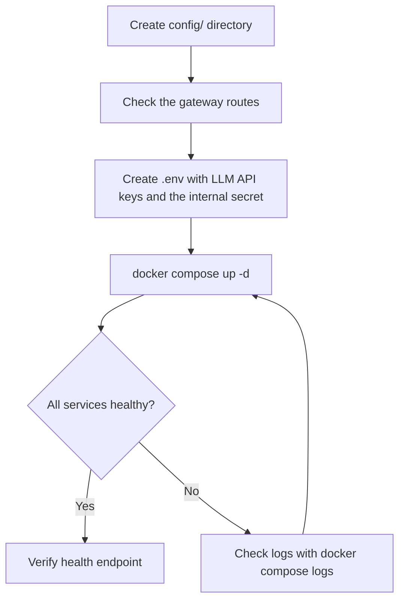
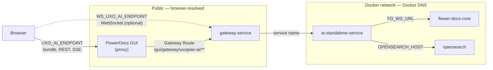

The [Getting Started quickstarts](../getting_started/quickstart.mdx) use `DevProvider` with no authentication. This guide configures a production Docker Compose deployment with a real authentication provider.



*Figure: Docker Compose deployment steps for a production stack.*

## Differences from the quickstart

| | Getting Started | Production |
|---|---|---|
| Gateway provider | `DevProvider` (no auth) | `FlowerDocsProvider` or custom |
| Spring profile | `dev` | _(default)_ |
| Context path | `/` | `/gui/gateway/uxopian-ai` |
| TLS | None | Handled by reverse proxy |

:::note[No Java needed on the host]
The `uxopian-ai` and `uxopian-gateway` images embed their own Temurin 25 runtime, already started with `--enable-native-access=ALL-UNNAMED`. No JDK is required on the Docker host. See [Requirements](./requirements.md#java-runtime).
:::

## Compose file structure

A production stack requires the same three services as the quickstart. Use the `${VAR:-fallback}` pattern for image versions so the stack works without a `.env` file and stays in sync with the version management script.

```yaml
services:
  opensearch:
    image: opensearchproject/opensearch:${OPENSEARCH_VERSION:-3.6.0}
    environment:
      - discovery.type=single-node
      - DISABLE_SECURITY_PLUGIN=true
      - OPENSEARCH_JAVA_OPTS=-Xms512m -Xmx512m
    volumes:
      - opensearch-data:/usr/share/opensearch/data
    healthcheck:
      test: ["CMD-SHELL", "curl -f http://localhost:9200/_cluster/health || exit 1"]
      interval: 10s
      timeout: 5s
      retries: 5
      start_period: 20s

  # The service name is the host name the gateway's built-in routes call.
  ai-standalone-service:
    image: ${REGISTRY:-artifactory.arondor.cloud:5001}/uxopian-ai:${UXOPIAN_VERSION:-2026.0.0}
    # image: docker.uxopian.com/preview/uxopian-ai:${UXOPIAN_VERSION:-2026.0.0}
    depends_on:
      opensearch:
        condition: service_healthy
    environment:
      - JAVA_OPTS=-Xmx768m -Xms512m
      - OPENSEARCH_HOST=opensearch
      - OPENSEARCH_PORT=9200
      - APP_BASE_URL=https://your-domain.example.com
      - CONTEXT_PATH=/gui/gateway/uxopian-ai
      - FD_WS_URL=http://flower-docs-core:8081/core/
      - LLM_DEFAULT_PROVIDER=openai
      - LLM_DEFAULT_MODEL=gpt5
      - LLM_DEFAULT_PROMPT=basePrompt
      - LLM_CONTEXT_SIZE=10
      - OPENAI_API_KEY=${OPENAI_API_KEY:-}
      - INTERNAL_AUTH_JWT_SECRET=${INTERNAL_AUTH_JWT_SECRET:?set it in .env}
    volumes:
      - ./config:/app/config:ro

  gateway-service:
    image: ${REGISTRY:-artifactory.arondor.cloud:5001}/uxopian-gateway:${UXOPIAN_VERSION:-2026.0.0}
    # image: docker.uxopian.com/preview/uxopian-gateway:${UXOPIAN_VERSION:-2026.0.0}
    depends_on:
      - ai-standalone-service
    ports:
      - "8085:8085"
    environment:
      - JAVA_OPTS=-Xmx256m -Xms256m
      - INTERNAL_AUTH_JWT_SECRET=${INTERNAL_AUTH_JWT_SECRET:?set it in .env}

volumes:
  opensearch-data:
```

`LLM_DEFAULT_MODEL` names a model **configuration** (`llmModelConfName` in `config/llm-clients-config.yml`), not a model id. See [Configure LLM providers](../how_to/configure_llm_providers.md#which-provider-and-model-runs-a-call).

The Cloudsmith public registry (`docker.uxopian.com/preview/`) does not require login. Uncomment the `docker.uxopian.com` image lines and remove the default registry lines to use it instead of Artifactory.

## Gateway configuration

### FlowerDocs deployment

The gateway image ships its own `/app/application.yml`. Its routes already cover FlowerDocs, so a FlowerDocs deployment mounts no gateway file:

| Route | Path | Target | Provider |
|---|---|---|---|
| `uxopian-ai` | `/**/uxopian-ai/**` | `http://ai-standalone-service:8080` | `FlowerDocsProvider` |
| `uxopian-ai-ws` | `/**/uxopian-ai/ws/**` | `ws://ai-standalone-service:8080` | public |

Both forward the path unchanged. Hence the two names in the Compose file above: the uxopian-ai service is called `ai-standalone-service`, and uxopian-ai runs with `CONTEXT_PATH=/gui/gateway/uxopian-ai`, the path FlowerDocs' Route sends (see [Configure FlowerDocs scope files](../how_to/configure_flowerdocs_scope.mdx#gatewayxml-route)).

### Replacing the built-in configuration

To change the routes (another provider, another service name, extra security rules), mount your own file **at `/app/application.yml`**:

```yaml
    volumes:
      - ./gateway-application.yml:/app/application.yml:ro
```

The mounted file replaces the built-in one entirely, so start from a copy of it:

```bash
docker run --rm --entrypoint cat \
  artifactory.arondor.cloud:5001/uxopian-gateway:2026.0.0 /app/application.yml > gateway-application.yml
```

:::warning[Mount at `application.yml`, not `application.yaml`]
A file mounted at `/app/application.yaml` sits next to the built-in `/app/application.yml`, and the `.yml` file wins for every key both define. The route list comes entirely from the built-in file: your routes are ignored and the gateway keeps calling `ai-standalone-service` (`500`, `UnknownHostException` in the gateway log).
:::

For other authentication providers, replace `FlowerDocsProvider` with the appropriate provider name. See [Authentication and gateway](../understanding/authentication.md).

## Config files

Mount a `config/` directory into uxopian-ai at `/app/config`. The quickstart Docker example ZIP includes a ready-to-use `config/` directory. In production, the files that typically need adjustment are:

- `llm-clients-config.yml` — provider, model, timeouts, API key references
- `prompts.yml` — system prompt customization
- `application.yml` — base URL and context path overrides

See [Getting Started: Docker quickstart](../getting_started/quickstart.mdx) for the full list of config files.

## Environment file

Create a `.env` file alongside the Compose file to supply LLM API keys:

```bash
OPENAI_API_KEY=sk-your-key
# ANTHROPIC_API_KEY=your-key
# GEMINI_API_KEY=your-key
```

Set at least one key matching the `LLM_DEFAULT_PROVIDER` configured in the service environment.

### Internal authentication secret

`INTERNAL_AUTH_JWT_SECRET` is **required** on uxopian-ai in every profile, `dev` included: the service refuses to start without it. The gateway signs an `X-Gateway-Auth` assertion with the same secret, and uxopian-ai refuses any request that does not carry a valid one (so a caller that reaches uxopian-ai directly cannot choose its own tenant or roles; the `dev` profile does not verify the assertion but still requires the secret). Use the same value of at least 32 bytes on both services:

```bash
echo "INTERNAL_AUTH_JWT_SECRET=$(openssl rand -base64 48)" >> .env
```

`INTERNAL_AUTH_JWT_ISSUER` (default `uxopian-gateway-internal`) must match the issuer the gateway uses. An assertion without an `exp` claim is refused.

## Optional services and folders

| Feature | What to add |
|---|---|
| Review screen, ARender rendition | `RENDITION_BASE_URL` pointing at the ARender service. uxopian-ai relays `/rendition/` to it behind the gateway authentication, so the browser no longer needs to reach ARender. See [Human review](../how_to/human_in_the_loop_review.md) |
| Filesystem connector and `persist` attachments | Mount a writable folder and set `FILECONNECTOR_FILESYSTEM_ROOT` (and optionally `FILECONNECTOR_FILESYSTEM_ALLOWEDEXTENSIONS`, default `pdf,png,jpg,jpeg,tif,tiff`). Each tenant works under `<root>/<tenant>/`. The service stops at startup if the folder is missing, unreadable or not writable by the application user |
| [Code modules](../how_to/code_modules.md) | Deploy uxopian-code-sandbox and set the `code-sandbox.url` and `code-sandbox.secret` properties (environment variables `CODESANDBOX_URL` and `CODESANDBOX_SECRET`). Empty URL = feature off |
| Uploaded files kept with a request | `LLM_FILES_RETENTION` (property `llm.files.retention`, default one day, `0` keeps nothing) |

```yaml
  uxopian-ai:
    environment:
      - FILECONNECTOR_FILESYSTEM_ROOT=/data/documents
    volumes:
      - ./documents:/data/documents
```

## Hazelcast on a shared network

Hazelcast auto-detection is always off. Outside Kubernetes, nodes find each other by multicast, which is on by default (`HAZELCAST_MULTICAST_ENABLED=true`). On a single node, or on a Docker network without multicast, set `HAZELCAST_MULTICAST_ENABLED=false`: it also stops a node from trying to join a cluster of another version that happens to run on the same machine. A deployment that silently relied on auto-detection no longer forms a cluster.

## Upgrading from 2026.0.0-ft5

Stop the stack. The OpenSearch data model changed since 2026.0.0-ft5 and no automatic migration is provided between fasttrack versions: export what you need and re-create it in 2026.0.0, or start on new indices (see [Upgrading from 2026.0.0-ft5](./kubernetes.mdx#upgrading-from-202600-ft5)). Also:

- add `INTERNAL_AUTH_JWT_SECRET` to uxopian-ai and to the gateway (see above);
- remove `OPENSEARCH_FORCE_REFRESH_INDEX` and `force-refresh-index` from `config/opensearch.yml`: they no longer do anything;

## Docker networking and URL configuration

This is the most common source of misconfiguration. Containers communicate differently depending on whether the caller is another container or a user's browser.

### The two-URL rule

Every URL in the stack belongs to one of two contexts:

| Context | Who resolves it | Use |
|---|---|---|
| **Container → container** | Docker DNS, inside the network | Service-to-service calls (uxopian-ai → OpenSearch, uxopian-ai → FlowerDocs core, gateway → uxopian-ai) |
| **Browser → server** | Public DNS / host machine | URLs loaded in user browsers (gateway public URL, `UXOPIAN_AI_HOST`, JS `UXO_AI_ENDPOINT`) |

**Container-to-container URLs use the Docker service name as hostname.** This name is the key under `services:` in the Compose file (not `container_name`). Docker's embedded DNS resolves it to the container's internal IP automatically.

```yaml
services:
  opensearch:          # ← Docker service name → hostname "opensearch"
    ...
  uxopian-ai:          # ← hostname "uxopian-ai"
    environment:
      - OPENSEARCH_HOST=opensearch   # ✓ service name
      - OPENSEARCH_HOST=localhost    # ✗ localhost = the uxopian-ai container itself
      - OPENSEARCH_HOST=192.168.1.x  # ✗ host IP — fragile, breaks in CI/CD
```

:::warning[localhost means the container, not the host machine]
Inside a Docker container, `localhost` and `127.0.0.1` resolve to the container itself, not to the Docker host. A URL like `http://localhost:8080/core/` set in `FD_WS_URL` will always fail — even if FlowerDocs is running on port 8080 on the host.
:::

### Environment variable mapping

The variables listed below split cleanly into the two contexts. Set them accordingly:

**Container-to-container (use Docker service names):**

| Variable | Who reads it | Points to |
|---|---|---|
| `OPENSEARCH_HOST` | uxopian-ai | OpenSearch service name (e.g. `opensearch`) |
| `FD_WS_URL` | uxopian-ai | FlowerDocs Core service (e.g. `http://flower-docs-core:8081/core/`) |
| `RENDITION_BASE_URL` | uxopian-ai | ARender DSB service (e.g. `http://dsb-service:8761`). Also the target of the `/rendition/` relay |
| `ALFRESCO_BASE_URL` | uxopian-ai | Alfresco repository (e.g. `http://alfresco:8080`) |
| `app.routes[].uri` | gateway | uxopian-ai service (`http://ai-standalone-service:8080` in the built-in routes) |

**Browser-side (use public host URL or IP):**

| Variable | Who reads it | Points to |
|---|---|---|
| `APP_BASE_URL` | uxopian-ai (link generation) | Public gateway URL (e.g. `https://my-server.example.com`) |
| `UXOPIAN_AI_HOST` | ARender UI, Alfresco Share | Public gateway URL as seen by browsers |
| `UXO_AI_ENDPOINT` (in FlowerDocs scope JS `consts/`) | User's browser | FlowerDocs' own address, `/gui/plugins/<scope>/gateway/uxopian-ai`, proxied to the gateway |
| `WS_GATEWAY_URL_RAW` (in FlowerDocs scope JS `consts/`, optional) | User's browser | Public gateway URL, for the WebSocket channel only |

### All services on the same network

Services that need to communicate must be on the same Docker network. Declare a named network and attach all services to it:

```yaml
services:
  opensearch:
    networks:
      - uxopian-ai-net

  uxopian-ai:
    networks:
      - uxopian-ai-net

  uxopian-gateway:
    ports:
      - "8085:8085"    # Only the gateway is exposed to the host
    networks:
      - uxopian-ai-net

networks:
  uxopian-ai-net:      # Named network — Docker creates it automatically
```

Only `uxopian-gateway` has a `ports:` mapping. `uxopian-ai` and `opensearch` use `expose:` or no port mapping — they are reachable within the network but not from outside.

### Connecting to an external service (FlowerDocs, Alfresco, ARender)

When the host application runs in a separate Docker Compose stack, uxopian-ai must join its network to reach it by service name — or use the host machine's IP.

**Option A — Join the external network (recommended):**

```yaml
# In the Uxopian AI docker-compose.yml
services:
  uxopian-ai:
    environment:
      - FD_WS_URL=http://flower-docs-core:8081/core/   # Service name from the FD stack
    networks:
      - uxopian-ai-net
      - flowerdocs-net                                  # Join the FD network

networks:
  uxopian-ai-net:
  flowerdocs-net:
    external: true     # References a network created by the FlowerDocs Compose stack
    name: flowerdocs_default  # Exact name — check with: docker network ls
```

Find the exact network name with:
```bash
docker network ls
docker inspect <flowerdocs-container> | grep -i network
```

**Option B — Use the host machine IP:**

```yaml
FD_WS_URL=http://172.17.0.1:8081/core/   # Docker bridge gateway IP (Linux default)
# or
FD_WS_URL=http://host.docker.internal:8081/core/   # Works on Mac/Windows Docker Desktop
```

This option works without network changes but binds the config to a specific IP. Prefer Option A in production.

### FlowerDocs integration — complete network picture

In a FlowerDocs deployment, the browser only talks to FlowerDocs, except for the optional WebSocket:



- **`UXO_AI_ENDPOINT`** (`/gui/plugins/<scope>/gateway/uxopian-ai`) — the warm-up ping, the JS bundle, every REST call and SSE stream go through FlowerDocs' proxy, which forwards them to the gateway's Route URL (`http://gateway-service:8085/gui/gateway`).
- **`WS_UXO_AI_ENDPOINT`** (optional) — the WebSocket goes straight to the gateway's public address, because FlowerDocs' proxy cannot forward it. See [Configure FlowerDocs scope files](../how_to/configure_flowerdocs_scope.mdx#why-websocket-needs-a-separate-direct-endpoint).
- **`FD_WS_URL`** — container-to-container, must use the Docker service name (`flower-docs-core`), never `localhost`.

### Checking service name resolution

From inside a container, verify DNS resolution and connectivity:

```bash
# Enter the uxopian-ai container
docker exec -it <uxopian-ai-container> sh

# Check service name resolution
nslookup flower-docs-core
ping -c1 flower-docs-core

# Check the actual URL works
curl http://flower-docs-core:8081/core/actuator/status
curl http://dsb-service:8761/ActionsAPI
curl http://opensearch:9200/_cluster/health
```

If `nslookup` returns `NXDOMAIN`, the two containers are not on the same Docker network. Fix by joining the external network (see Option A above) or by using the host IP (Option B).

## TLS and reverse proxy

Expose port `8085` of `uxopian-gateway` behind a reverse proxy (nginx, Traefik, or a cloud load balancer) that terminates TLS. The gateway itself runs plain HTTP internally.

## Start and verify

```bash
docker compose up -d
```

```bash
curl http://localhost:8085/gui/gateway/uxopian-ai/actuator/health
```

Expected:

```json
{"status":"UP"}
```
