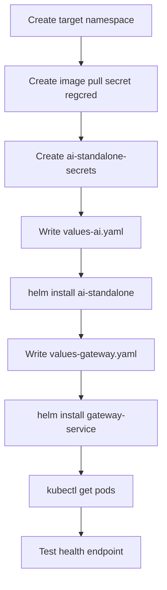
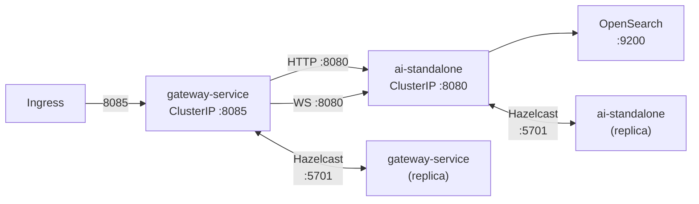

import Tabs from '@theme/Tabs';
import TabItem from '@theme/TabItem';

Two Helm charts cover the full deployment: `ai-standalone` for the AI backend and `gateway-service` for the routing and authentication layer.

:::tip Download the charts
<a href="/docs/helm/component-ai.zip" download>component-ai.zip</a> — AI backend chart<br/>
<a href="/docs/helm/gateway-service.zip" download>gateway-service.zip</a> — Gateway chart
:::



*Figure: Kubernetes deployment steps for a full Uxopian AI stack.*



*Figure: Kubernetes service topology. Each service maintains its own Hazelcast cluster for session state.*

## Prerequisites

- Kubernetes 1.24+
- `helm` 3.x
- `kubectl` configured for the target cluster
- Image pull secret (`regcred`) in the target namespace
- An OpenSearch instance reachable from the cluster

## Image pull secret

```bash
kubectl create secret docker-registry regcred \
  --docker-server=artifactory.arondor.cloud:5001 \
  --docker-username=<your-username> \
  --docker-password=<your-password> \
  --namespace=<your-namespace>
```

## Deploy ai-standalone

### Configure values

Create a `values-ai.yaml` overriding the defaults for your environment:

```yaml
image:
  registry: artifactory.arondor.cloud:5001
  repository: uxopian-ai
  tag: "2026.0.0"

appConfig:
  openSearch:
    host: "opensearch-service"        # OpenSearch service name in the cluster
    port: "9200"
  externalUrls:
    appBaseUrl: "https://your-domain.example.com"
    renditionBaseUrl: "http://arender-rendition-broker:8761"   # ARender only
    flowerDocsWsUrl: "http://flower-docs-core:8081/core/"       # FlowerDocs only
  contextPath: "/gui/gateway/uxopian-ai"
  llm:
    defaultProvider: "openai"
    defaultModel: "gpt-4.1"
    defaultPrompt: "basePrompt"
    contextSize: "10"

resources:
  requests:
    memory: "512Mi"
    cpu: "500m"
  limits:
    memory: "1Gi"
    cpu: "1000m"
```

### Set the internal authentication secret

ai-standalone refuses to start without `INTERNAL_AUTH_JWT_SECRET`, and the chart refuses to render without it. It is the shared secret the gateway signs its `X-Gateway-Auth` identity assertion with and ai-standalone verifies. It must be the same string, at least 32 bytes, on both charts, and the gateway must already sign with it or every request answers `401`.

```bash
openssl rand -base64 48 > internal-auth.secret

helm upgrade --install ai-standalone ./component-ai \
  -f values-ai.yaml \
  --set-file appConfig.internalAuth.secret=internal-auth.secret \
  --namespace <your-namespace>
```

With a GitOps tool that has no `--set-file` (ArgoCD), create the Secret yourself and name it instead. It must carry the key `INTERNAL_AUTH_JWT_SECRET`:

```yaml
appConfig:
  internalAuth:
    existingSecret: "uxopian-internal-auth"
```

An assertion without an `exp` claim is refused with `401`. The official gateway always sets one (30 seconds), so only hand-made tokens are affected.

### Allow the callers of the API port

The ai-standalone chart always renders a `NetworkPolicy`, with no switch to turn it off. The API port accepts only the clients listed in `networkPolicy.allowedClients`, and the Hazelcast port (5701) accepts only the other replicas. Egress is open. By default the only allowed client is the pod labelled `app.kubernetes.io/name: gateway-service` in the release namespace.

Add every other pod that calls the API directly (a FlowerDocs or ICN pod, Prometheus):

```yaml
networkPolicy:
  allowedClients:
    - podSelector:
        matchLabels:
          app.kubernetes.io/name: gateway-service
    - podSelector:
        matchLabels:
          app.kubernetes.io/name: prometheus
```

An empty list fails the render, so exposing the port is always explicit. Check that the namespace and labels match your gateway chart. The cluster needs a CNI that enforces NetworkPolicy.

### Mount a document folder (optional)

Two features write or read files from a folder shared with the pod: the filesystem connector (documents the review screen and tools read by path) and request attachments sent with `persist: true`. Both use the same root. Nothing mounted means the filesystem connector does not exist and `persist` is refused with `422 FILE_STORAGE_UNAVAILABLE`.

```yaml
fileConnector:
  filesystem:
    existingClaim: "uxopian-documents"   # an existing PersistentVolumeClaim
    mountPath: /data/documents
    allowedExtensions: "pdf,png,jpg,jpeg,tif,tiff"   # empty = this default list
```

When `existingClaim` is set, the chart mounts the claim at `mountPath` and sets `FILECONNECTOR_FILESYSTEM_ROOT` and `FILECONNECTOR_FILESYSTEM_ALLOWEDEXTENSIONS`. Each tenant works under `<root>/<tenant>/`. Paths with `..`, absolute paths, hidden segments, extensions outside the list and symbolic links that leave the root are refused. The application **fails fast at startup** if the root is not a folder, not readable, or not writable by the application user (it writes a temporary probe file). Make the volume writable for the container user.

### Code sandbox (optional)

[Code modules](../how_to/code_modules.md) run in a separate service, uxopian-code-sandbox. Set the `code-sandbox.url` and `code-sandbox.secret` properties of ai-standalone (as environment variables, Spring maps them to `CODESANDBOX_URL` and `CODESANDBOX_SECRET`). With no URL the feature is off and no code tool is offered. The domains a module may call are configured on the sandbox side.

### Create the API keys secret

The chart reads LLM API keys from a Kubernetes secret named `ai-standalone-secrets`. Create it before deploying:

```bash
kubectl create secret generic ai-standalone-secrets \
  --from-literal=OPENAI_API_KEY=sk-your-key \
  --namespace=<your-namespace>
```

Add keys for any other providers you use (`ANTHROPIC_API_KEY`, `GEMINI_API_KEY`, `AZURE_OPENAI_API_KEY`, `NUEXTRACT_API_KEY`). Keys for unused providers can be omitted.

### Install

```bash
helm install ai-standalone ./component-ai \
  -f values-ai.yaml \
  --namespace <your-namespace>
```

### Upgrade

```bash
helm upgrade ai-standalone ./component-ai \
  -f values-ai.yaml \
  --namespace <your-namespace>
```

## Deploy gateway-service

### Configure values

Create a `values-gateway.yaml`. The most important section is `files.application.yaml`, which defines the routes and authentication provider.

<Tabs>
  <TabItem value="flowerdocs" label="FlowerDocsProvider">

```yaml
image:
  repository: artifactory.arondor.cloud:5001/uxopian-gateway
  tag: "2026.0.0"

hazelcast:
  enabled: true
  clusterName: "uxopian-gateway-cluster"
  javaOpts: "-Xmx256m -Xms256m"

files:
  application.yaml: |
    app:
      routes:
        - id: uxopian-ai
          uri: http://ai-standalone-service:8080
          prefix: /gui/gateway/uxopian-ai/
          path: /gui/gateway/uxopian-ai/**
          provider: FlowerDocsProvider
          security:
            - path: /.well-known/**
              public: true
            - path: /assets/**
              public: true
            - path: /v3/**
              public: true
            - path: /actuator/health
              public: true
            - path: /prompt/**
              roles: ["ADMIN"]
            - path: /goal/**
              roles: ["ADMIN"]
            - path: /prompt-statistics
              roles: ["ADMIN"]
        - id: uxopian-ai-ws
          uri: ws://ai-standalone-service:8080
          path: /gui/gateway/uxopian-ai/ws/**
          prefix: /gui/gateway/uxopian-ai/ws/
          security:
            - path: /**
              public: true
    server:
      port: 8085
```

  </TabItem>
  <TabItem value="devprovider" label="DevProvider (dev only)">

```yaml
files:
  application.yaml: |
    app:
      routes:
        - id: uxopian-ai
          uri: http://ai-standalone-service:8080
          prefix: /
          path: /**
          provider: DevProvider
          security:
            - path: /actuator/health
              public: true
    server:
      port: 8085
```

:::warning
`DevProvider` disables authentication. Use only in development namespaces.
:::

  </TabItem>
</Tabs>

### Install

```bash
helm install gateway-service ./gateway-service \
  -f values-gateway.yaml \
  --namespace <your-namespace>
```

## Upgrading from 2026.0.0-ft5

`helm upgrade` is not enough on a cluster that already holds data.

1. **Transfer your data.** The OpenSearch data model changed since 2026.0.0-ft5: new fields, new indices, Applications replaced by usage profiles, entities identified by id. No automatic migration is provided between fasttrack versions. Export what you need (prompts, agents, plans, scripts, MCP servers, LLM providers, usage profiles) from the ft5 deployment and re-create it in 2026.0.0, or start on new indices. Existing conversations and requests are not carried over unless you transfer them yourself. Stop or finish running plan runs before you switch.
2. **Update your values.** Remove `appConfig.openSearch.forceRefresh` (harmless if left, the property no longer does anything), set the internal authentication secret, and list the extra callers of the API in `networkPolicy.allowedClients`.

## Embedded config files

The chart mounts a ConfigMap at `/app/config/` containing four YAML files. You can override any of them inline under `files` in your `values-ai.yaml`.

The most common override is switching the ECM integration. `flowerdocs` and `alfresco` are mutually exclusive — enable one or the other:

<Tabs>
  <TabItem value="flowerdocs" label="FlowerDocs (default)">

```yaml
files:
  application.yml: |+
    plugins:
      tools:
        enabled-tags: flowerdocs,files
```

  </TabItem>
  <TabItem value="alfresco" label="Alfresco">

```yaml
files:
  application.yml: |+
    plugins:
      tools:
        enabled-tags: alfresco,files
```

  </TabItem>
</Tabs>

Alternatively, set the environment variable `PLUGINS_TOOLS_ENABLED_TAGS` directly instead of overriding the file.

You can also override `hazelcast.yml`, `llm-clients-config.yml`, and `prompts.yml` the same way — paste the full file content under the corresponding key.

## Hazelcast clustering

Both services discover cluster peers through a Kubernetes headless service. The headless service (`<name>-headless`) and the required RBAC resources (ServiceAccount, ClusterRole, ClusterRoleBinding) are created automatically by the charts.

The two Hazelcast clusters are independent:
- `uxopian-ai-cluster` — session token cache shared across ai-standalone replicas
- `uxopian-gateway-cluster` — session validation cache shared across gateway replicas

No additional configuration is needed beyond setting `hazelcast.enabled: true` (the default).

## Verification

Check that both pods are running:

```bash
kubectl get pods -n <your-namespace>
```

Test the gateway health endpoint:

```bash
curl https://your-domain.example.com/gui/gateway/uxopian-ai/actuator/health
```

Expected response:

```json
{"status":"UP"}
```

## Key values reference

<Tabs>
  <TabItem value="ai" label="ai-standalone">

| Path | Description |
|---|---|
| `image.tag` | Image version — use `2026.0.0` |
| `appConfig.openSearch.host` | OpenSearch service hostname |
| `appConfig.openSearch.port` | OpenSearch port (default `9200`) |
| `appConfig.externalUrls.appBaseUrl` | Public URL of the application (used in generated links) |
| `appConfig.externalUrls.renditionBaseUrl` | ARender DSB URL (ARender integration only). Also the target of the `/rendition/` relay used by the [review screen](../how_to/human_in_the_loop_review.md) |
| `appConfig.externalUrls.flowerDocsWsUrl` | FlowerDocs core web service URL (FlowerDocs integration only) |
| `appConfig.contextPath` | Servlet context path, must match gateway route prefix |
| `appConfig.internalAuth.secret` | Shared secret with the gateway, 32 bytes minimum. Pass it with `--set-file` |
| `appConfig.internalAuth.existingSecret` | Name of an existing Secret carrying the key `INTERNAL_AUTH_JWT_SECRET`, instead of `secret` |
| `appConfig.internalAuth.issuer` | Expected issuer of the assertion (default `uxopian-gateway-internal`) |
| `networkPolicy.allowedClients` | Pods allowed to reach the API port. Default: the gateway-service pod. Never empty |
| `fileConnector.filesystem.existingClaim` | PVC holding the documents. Empty = no filesystem connector |
| `fileConnector.filesystem.mountPath` | Mount point and connector root (default `/data/documents`) |
| `fileConnector.filesystem.allowedExtensions` | Comma-separated extensions the connector accepts |
| `appConfig.llm.defaultProvider` | Default LLM provider (`openai`, `anthropic`, `gemini`, etc.) |
| `appConfig.llm.defaultModel` | Default model name |
| `appConfig.llm.defaultPrompt` | ID of the default system prompt (default `basePrompt`) |
| `appConfig.llm.contextSize` | Number of conversation turns kept in context (default `10`) |
| `appConfig.javaOpts` | JVM flags (default `-Xmx768m -Xms512m`) |
| `existingSecret` | Name of the K8s secret holding LLM API keys (default `ai-standalone-secrets`) |
| `hazelcast.enabled` | Enable K8s-based Hazelcast peer discovery |
| `files.application.yml` | Override the embedded `application.yml` (plugins, context path, etc.) |
| `files.hazelcast.yml` | Override the embedded `hazelcast.yml` (cluster name, discovery) |
| `files.llm-clients-config.yml` | Override the embedded LLM provider configuration |
| `files.prompts.yml` | Override the embedded prompt definitions |

  </TabItem>
  <TabItem value="gateway" label="gateway-service">

| Path | Description |
|---|---|
| `image.tag` | Image version — use `2026.0.0` |
| `hazelcast.javaOpts` | JVM flags (default `-Xmx256m -Xms256m`) |
| `hazelcast.clusterName` | Hazelcast cluster name — keep distinct from ai-standalone |
| `files.application.yaml` | Full gateway config: routes, providers, security rules |

  </TabItem>
</Tabs>
