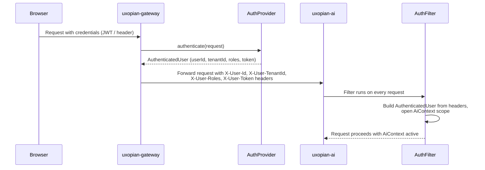

Authentication in Uxopian AI is handled entirely by `uxopian-gateway`. The backend (`uxopian-ai`) does not perform authentication itself. It receives identity information through HTTP headers that the gateway injects after a successful authentication check.

## Authentication flow



*Figure: Authentication flow from browser through gateway to uxopian-ai.*

## The AuthProvider interface

The gateway authenticates every request by calling an `AuthProvider`. An `AuthProvider` inspects the request and returns an `AuthenticatedUser` carrying `userId`, `roles`, `tenantId`, and the original token. If authentication fails, the request is rejected at the gateway.

Three built-in providers are included:

| Provider | When to use |
|---|---|
| `DevProvider` | Local development only. Since 2026.0.0-ft5, always returns a **fixed** identity (`dev`, tenant `dev`, role `ADMIN`) — it no longer reads any client-supplied header, so it can never be used to forge an arbitrary user or tenant (previously it trusted `X-User-Id`/`X-User-Roles`/`X-User-Tenant` with no validation). |
| `FlowerDocsProvider` | FlowerDocs deployments. Validates FlowerDocs JWTs from `Authorization: Bearer` or `SESSION` cookie. Caches sessions in Hazelcast. |
| `Fast2Provider` | Fast2 deployments. Validates Fast2 JWT tokens from `Authorization: Bearer`. |

The active provider is set per route in `gateway-application.yaml`:

```yaml
app:
  routes:
    - id: uxopian-ai
      uri: http://uxopian-ai:8080
      path: /**
      provider: DevProvider
```

## Identity headers

After authentication, the gateway forwards four headers to `uxopian-ai`:

| Header | Content |
|---|---|
| `X-User-Id` | Unique user identifier |
| `X-User-TenantId` | Tenant identifier — drives all data isolation |
| `X-User-Roles` | Comma-separated list of user roles |
| `X-User-Token` | Original credential token (forwarded for integrations that call back into the source system) |

`AuthFilter` also reads an optional **`X-Usage-Profile-Id`** header — not an identity header, but a caller-supplied selector that forces which [usage profile](../admin/managing_applications.md) the request resolves to, overriding the default that is otherwise derived from the connection provider. This header replaces `X-Application-Id` (2026.0.0-ft5): since 2026.0.0, *Applications* are called usage profiles and the old header is no longer read.

## Gateway-signed request authentication

The identity headers above are, by themselves, just headers: anything able to reach `uxopian-ai` directly (bypassing the gateway) could set `X-User-Id`/`X-User-TenantId`/`X-User-Roles` to impersonate any user. To close that gap, the gateway **signs** every request it forwards with a short-lived HS256 JWT, carried in the `X-Gateway-Auth` header, which `uxopian-ai` verifies before trusting the identity headers alongside it.

The assertion carries `sub` (user id), `tenantId`, `roles`, and `provider` as claims, with a default 30-second lifetime. It must carry an `exp` claim: an assertion without one is refused with `401`. The official gateway always sets it, so only hand-made tokens are affected. Both sides share one secret — the gateway signs with `internal-auth.jwt.secret`, `uxopian-ai` verifies with the same key under the identical property name (environment variable `INTERNAL_AUTH_JWT_SECRET`).

Since 2026.0.0, this secret is **mandatory** on `uxopian-ai` in every profile, `dev` included: the service refuses to start without it (previously, a missing secret silently disabled verification and bare `X-User-*` headers were accepted). The secret must be at least 32 bytes and identical on the gateway and on `uxopian-ai`; `internal-auth.jwt.issuer` defaults to `uxopian-gateway-internal`. Docker, Docker Compose and plain Java deployments must therefore set `INTERNAL_AUTH_JWT_SECRET` on both services; the official Helm charts already required it. See [Configuration — gateway-signed request authentication](../reference/configuration.md#gateway-signed-request-authentication) for every key and the exact rotation procedure.

## AuthFilter in uxopian-ai

`AuthFilter` (`OncePerRequestFilter`) reads these headers on every incoming request. It builds an `AuthenticatedUser` and opens an `AiResourceContext` scope using `AiContext.builder().withUser(authUser).open()`. All downstream services read tenant identity from `AiContext` rather than receiving it as parameters.

If `X-User-TenantId` is absent and the `dev` profile is not active, the request proceeds without a security context. Operations that require tenant data will fail because no tenant is resolvable.

## Dev profile

When `SPRING_PROFILES_ACTIVE=dev` is set on `uxopian-ai`, `AuthFilter` injects fallback defaults when headers are missing:

- `userId` defaults to `User-development`
- `tenantId` defaults to `Tenant-development`

This means any request reaches the backend without authentication (the gateway assertion itself is not verified in this profile, but `INTERNAL_AUTH_JWT_SECRET` must still be set for the service to start). Never use the `dev` profile in a production or publicly accessible environment.

In the Docker Compose quickstart, the gateway uses `DevProvider`, which reads identity from request headers. Combined with the `dev` profile on `uxopian-ai`, this allows browser testing without any credentials.

## Public routes

Some paths bypass authentication in the gateway. The default gateway configuration marks the following as public:

- `/assets/**`: static web component bundles
- `/actuator/health`: health check endpoint
- `/v3/**` and `/swagger-ui/**`: API documentation
- `/ws/**`: WebSocket endpoint for streaming

Admin API routes (`/api/v1/admin/**`) can be restricted by role using the `roles` field in the gateway security configuration.

## Session-cookie login (`/auth/login`)

Providers that need an explicit login exchange (FileNet's ICN plugin hand-off, for example) POST or GET `app.gateway.login-path` (default `/auth/login`) with a `providerId` and a token to mint a `GATEWAY_SESSION` cookie. Since 2026.0.0-ft5, this endpoint only accepts a `providerId` that's actually declared on one of the gateway's own routes — previously any registered `AuthProvider` bean name worked here, which meant `DevProvider` (a fixed, credential-less identity) could mint a session even on a deployment configured for a real provider. See [Integrate with FileNet](../how_to/integrate_with_filenet.mdx) for a worked example.

### Renewing an expired session from the opener window

When the admin console is opened from IBM Content Navigator with a short-lived (30-second) ICN token, the gateway session it creates lapses after 30 idle minutes and every call then answers `401`. Since 2026.0.0, the console renews the session itself through the window that opened it, using two `postMessage` messages:

1. On a `401`, the console posts `{ "type": "uxopian-ai:session-request" }` to its opener window.
2. The opener answers with `{ "type": "uxopian-ai:session", "loginUrl": "<url>" }`, a ready-to-open login URL.
3. The console accepts the URL only if it is on **its own origin**, opens it to get a new session cookie, then replays the failed request once. Several parallel failures share a single renewal.

If the opener does not answer within 5 seconds, the console shows a toast asking the user to reopen it from the application. A console opened on its own (no opener) keeps the plain `401` behavior. The ICN plugin answers only requests coming from the configured Uxopian AI host, and only to the window that asked, so the plugin must be updated to the version matching 2026.0.0 for renewal to work. Any other host application that opens the console can implement the same contract.

## Custom auth providers

A custom `AuthProvider` can be implemented in the gateway by writing a Spring bean that implements the `AuthProvider` interface (returns `Mono<AuthenticatedUser>`). The gateway configuration references the provider by its Spring bean name.

## Related pages

- [System architecture](./architecture.md)
- [Multi-tenancy](./multi_tenancy.md)
- [Quickstart with Docker Compose](../getting_started/quickstart.mdx)
