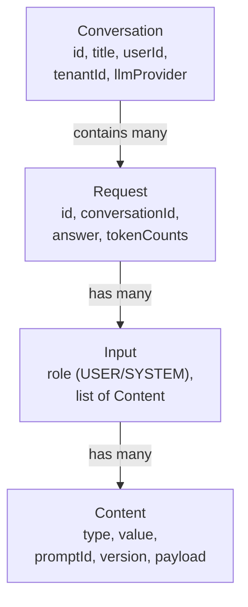

Conversations and requests are the two core runtime objects in Uxopian AI. A conversation is a chat session. A request is a single LLM round-trip within that conversation.

## Data model



*Figure: Relationship between Conversation, Request, Input, and Content objects.*

## Conversation

A conversation is a container for a series of requests. It stores metadata: title, userId, tenantId, the LLM provider and model used, and timestamps. Conversations are stored in the `conversations` OpenSearch index. The conversation's last activity is recorded at most once per minute (and immediately when its provider or model changes), so the "last activity" shown in the admin panel is accurate to the minute.

Creating a conversation is done implicitly when the first request is sent: the web component calls `createChat()` with the first request, which creates a conversation then submits it. Conversations can also be created explicitly via `POST /api/v1/conversations`.

### Automatic title generation

Starting with 2026.0.0-ft3, uxopian-ai asks the LLM to generate a meaningful conversation title when the first request of a new conversation (or the first request sent to a freshly created conversation) is processed. The title is produced through LangChain4J's structured-output feature: the same request returns both the user-facing answer and a short title used to label the conversation in the sidebar.

- Title-generation traffic is tracked as a **hidden request** attached to the same conversation: it counts in cost and token statistics but is not displayed to the end user in the conversation history.
- The feature relies on `ResponseFormat` support in the LLM request pipeline, so the configured default model must support structured output. Models that don't are silently skipped and the conversation keeps its default (first-message-derived) title.
- Titles are stored on the `Conversation` object and can be overridden manually via `PUT /api/v1/conversations/{id}`.

## Request

A request represents one LLM round-trip. It stores:

- `inputs`: the list of messages sent to the LLM, each as an `Input` object with a role and content parts
- `answer`: the LLM's response
- `inputTokenCount` and `outputTokenCount`: token usage
- `llmName`: the model that generated the response
- `feedback`: optional feedback ID attached to the response
- `toolCalls`: the trace of every tool the model called while producing the answer (tool type and name, arguments, result or error, start and end time, and the `log(...)` lines of a code tool), for blocking and streaming requests alike. Clients that validate the response against a strict schema must accept this field.

Requests are stored in the `requests` OpenSearch index. The context window (number of previous requests included in each LLM call) is controlled by `llm.context.size` in `llm-clients-config.yml` (default: 10).

## Content types

Each `Input` has a list of `Content` items. The `type` field determines how the content is interpreted:

| Type | Value field | Description |
|---|---|---|
| `text` | Free text | Sent to the LLM as literal text |
| `prompt` | Prompt ID | Resolved to the named prompt template and rendered with Thymeleaf |
| `base64` | Inline data URL (`data:<mime>;base64,...`) | Inline file of any type. An image is sent to the LLM as an image (requires a multimodal model); any other file is sent as a document |
| `document` | — (carries a `file` reference) | A file held by a file connector (for example `{ "connector": "request", "part": "<name>" }` for a file uploaded in the same multipart request). Sent to the model as a PDF; requires a model flagged as reading documents |

The former `image` content type is no longer accepted: send `base64` instead.

Inline file data is never returned inside a request or conversation. A content item only carries its `mimeType` and `size`, and the file is read from its own route, `GET /api/v1/requests/{request_id}/inputs/{input}/contents/{content}` (admin twin under `/api/v1/admin/requests/...`). Once the retention period has passed, the file is removed and the content is flagged `expired`; its type and size remain.

A document is only accepted by a model whose configuration has *Reads documents* switched on (`documentSupported`), see [Managing LLM providers](../admin/managing_llm_providers.md). Inline `base64` content larger than 5 MB is refused with `413`.

A `prompt` content item also accepts an optional `version` field (integer). Omitted, the request renders whichever version is currently **published**. Set it explicitly to render any other version instead — including an unpublished **draft** ([Managing prompts](../admin/managing_prompts.md#prompt-detail-page)). That's the actual point of drafting a prompt rather than editing it in place: a caller can exercise the draft through a real conversation, with real context and payloads, before anyone publishes it and makes it the version everyone else gets.

## Sending a request

The REST endpoint is `POST /api/v1/requests`. The request body follows the `Request` schema:

```json
{
  "conversation": "conv-id-or-null",
  "inputs": [
    {
      "role": "user",
      "content": [
        { "type": "prompt", "value": "arenderContext", "payload": { "documentId": "doc-123" } },
        { "type": "text", "value": "Summarize this document." }
      ]
    }
  ]
}
```

The request body can also be sent as `multipart/form-data`, with the JSON in a part named `request` and each file in its own part; the files are read for that call only.

The provider, model and temperature of a turn are not chosen by the request: they come from the prompt of the turn, then from the [usage profile](../admin/managing_applications.md#resolution-order) of the calling surface. The former `llm_provider`, `llm_model`, `temperature` and `reasoning` query parameters are no longer read. To attach a request to an existing conversation, set its `conversation` field.

## Streaming

Responses can be streamed over WebSocket. The client calls `window.connectWebSocket(wsEndpoint, userId)` to open a persistent connection to `/ws/{userId}`. While a request is being processed, tokens are sent over the WebSocket as they are generated by the LLM. The full response is also returned in the HTTP response body when the request completes.

## Request builders (JavaScript)

The web components bundle exposes three builder classes on the `window` object:

```javascript
const request = window.RequestBuilder.builder()
  .addInput(
    window.InputBuilder.builder()
      .role('USER')
      .addContent(window.ContentBuilder.ofPrompt('arenderContext', { documentId: 'doc-123' }))
      .addContent(window.ContentBuilder.ofText('Summarize this document.'))
      .build()
  )
  .build();

window.createChat({ endpoint: '', wsEndpoint: '/ws', request });
```

`request` is mandatory for `createChat`. To start a conversation from a prompt, put a `prompt` input in the request, for example `window.InputBuilder.promptAsUser('arenderContext', { documentId: 'doc-123' })`. To reopen an existing conversation, use `window.openChat({ endpoint, wsEndpoint, conversationId })`.

## Conversations in the admin panel

Administrators browse a user's conversations from the [user detail page](../admin/managing_users.md). Each request shows its question and answer, the model used and the token counts, plus:

- a collapsed **Tools used (n)** section between the question and the answer, listing the tool calls of the request (hidden when no tool was called, failed calls are flagged);
- the files the request references, as chips naming the file and its source (FlowerDocs version or file, filesystem folder, attachment size, FileNet class, Alfresco node); images are displayed, documents are offered as a download, and a file past its retention period is marked as no longer kept.

## Feedback

After a request completes, users can attach feedback by calling `PUT /api/v1/requests/{requestId}/feedback/{feedback}`. The feedback is stored as a string value on the request object and is visible in usage statistics.

## Related pages

- [Web components](./web_components.md)
- [Prompts and templating](./prompts_and_templating.md)
- [Managing users in the admin UI](../admin/managing_users.md)
- [Embed in a web application](../how_to/embed_in_web_application.md)
