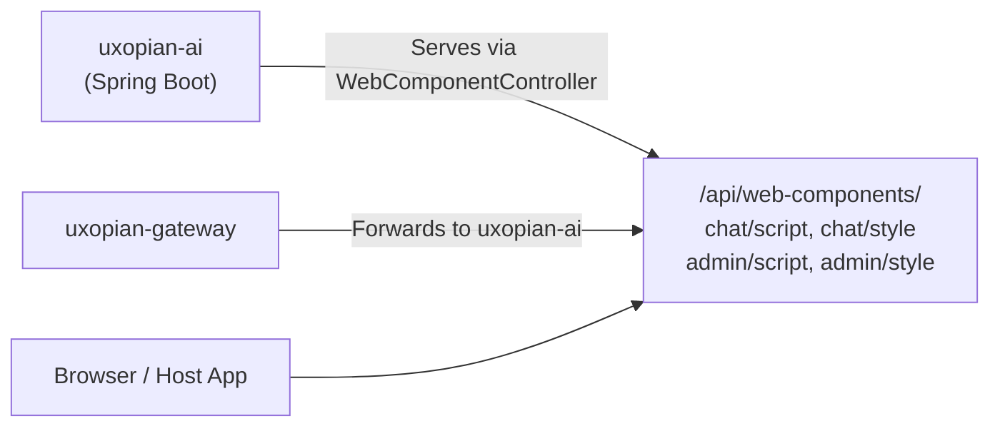

Uxopian AI ships standard HTML custom elements: `<chat-element>` and `<admin-element>`, plus the `quick-prompt-element` / `qp-toggle-button` pair introduced in 2026.0.0-ft4 and the `<viewer-element>` review screen. As of 2026.0.0, the admin console, chat and Quick Prompt share one look and one dark theme. They are built with React 19 and wrapped using `@r2wc/react-to-web-component`. They are self-contained and require no build step on the consuming application side.

## How the bundle is served



*Figure: The browser loads web component bundles from the gateway, which forwards to the WebComponentController in uxopian-ai.*

The web component bundles are compiled and embedded in the `uxopian-ai` image. They are served by `WebComponentController` under `/api/web-components/`. The gateway forwards these paths as public (no authentication required for static assets).

The served endpoints are:

| Asset | Endpoint |
|---|---|
| Chat JavaScript | `/api/web-components/chat/script` |
| Chat CSS | `/api/web-components/chat/style` |
| Admin JavaScript | `/api/web-components/admin/script` |
| Admin CSS | `/api/web-components/admin/style` |
| Quick Prompt JavaScript | `/api/web-components/quick-prompt/script` |
| Quick Prompt CSS | `/api/web-components/quick-prompt/style` |
| Viewer (review screen) JavaScript | `/api/web-components/viewer/script` |
| Viewer (review screen) CSS | `/api/web-components/viewer/style` |

To load the chat component, add these tags to the host application:

```html
<link rel="stylesheet" href="https://your-gateway/api/web-components/chat/style" />
<script src="https://your-gateway/api/web-components/chat/script"></script>
```

## chat-element

The chat interface custom element. Registered as `<chat-element>`. Accepts these attributes:

| Attribute | Type | Description |
|---|---|---|
| `endpoint` | string | Gateway origin as reachable from the browser (e.g., `https://gateway-host`). The component appends `/api/v1` itself — do **not** include it. |
| `wsendpoint` | string | WebSocket base URL (e.g., `wss://gateway-host/ws`) |
| `request` | string | JSON-serialized `Request` object. For a new conversation it holds the first request; to reopen a conversation it holds `{ "conversation": "<id>", "inputs": [] }` (this is what `openChat` builds) |

The element declares only these three attributes (`endpoint`, `wsendpoint`, `request`). The former `conversationid` and `promptid` attributes were never read and are gone: use `window.openChat` / `window.createChat` below.

## admin-element

The admin interface custom element. Registered as `<admin-element>`. Uses React Router internally with these routes:

| Route | Content |
|---|---|
| `/` | Dashboard |
| `/prompts`, `/prompts/:id` | Prompt list, prompt detail and editor |
| `/llm-providers`, `/llm-providers/:id` | LLM provider list and configuration |
| `/mcp-servers`, `/mcp-servers/:id` | MCP server list and configuration |
| `/usage-profiles`, `/usage-profiles/:id` | Usage profile list and configuration |
| `/scripts`, `/scripts/:id` | Script list and editor |
| `/code-modules`, `/code-modules/:id` | Code module list and editor |
| `/agents`, `/agents/:id` | Agent list and editor |
| `/plans`, `/plans/:id` | Plan list, flow editor and runs |
| `/users`, `/users/:id` | User list with conversation statistics, user detail |
| `/statistics` | Usage statistics and charts |

Creation pages live under `/<section>/new/edit`. The admin console is served with a strict Content-Security-Policy and cannot be framed: embed it through the `<admin-element>` web component, not an `<iframe>`.

## viewer-element

The human-review screen, registered as `<viewer-element>`, served from its own bundle (`/api/web-components/viewer/script` + `/style`) and also available as a page at `<app>/viewer`. It accepts an `endpoint` attribute (the gateway origin, as for the other elements) and a boolean `mock` attribute (`?mock=true` on the page) that serves a mock task queue. The bundle exposes `window.createViewer({ endpoint?, mock?, target? })` to mount it. The admin sidebar links to it as **Review tasks**, which opens it in a new tab.

## quick-prompt-element

The context-aware [Quick Prompt](./quick_prompt.md) panel, registered as `quick-prompt-element`, with a companion `qp-toggle-button`. Introduced in 2026.0.0-ft4 and served from its own bundle (`/api/web-components/quick-prompt/script` + `/style`).

Unlike the chat and admin elements, Quick Prompt is driven through a JavaScript **integration handle** rather than HTML attributes. The bundle exposes:

| Global | Purpose |
|---|---|
| `window.createQuickPromptIntegration({ endpoint, target?, onClose? })` | Creates the panel and returns the integration handle (`setTenant`, `setUser`, `setRoutes`, `setDocument`, `setTask`, `setFolder`, `setInjected`, `setCallbacks`, `getContext`, `destroy`) |
| `window.createQuickPrompt({ endpoint, target?, onClose? })` | Lower-level helper that only mounts the element |
| `window.uxopian.mapComponent(obj, fields)` | Helper to remap a host object's fields onto the Quick Prompt context shape |

See [Embed Quick Prompt](../how_to/embed_quick_prompt.mdx) for the full integration workflow.

## Global window API

The chat bundle exposes these functions on the `window` object:

### `window.openChat(params)`

Reopens an existing conversation. It sets the conversation in the `request` of the chat element, so the history of that conversation is displayed and the next message continues it.

```javascript
window.openChat({
  endpoint: 'https://gateway',
  wsEndpoint: 'wss://gateway/ws',
  conversationId: 'existing-conv-id'
});
```

### `window.createChat(params)`

Creates a new conversation by sending an initial request. `request` is **mandatory**.

```javascript
window.createChat({
  endpoint: 'https://gateway',
  wsEndpoint: 'wss://gateway/ws',
  request: requestObject
});
```

To start the conversation from a prompt, put a `prompt` input in the request:

```javascript
const request = window.RequestBuilder.builder()
  .addInput(window.InputBuilder.promptAsUser('arenderContext', { documentId: 'doc-123' }))
  .build();
```

:::warning[`promptId` was removed]
Earlier versions documented an optional `promptId` parameter on `createChat`. It never had any effect and has been removed from the parameters; calling `createChat` without `request` is no longer valid. Replace it with a `prompt` input as shown above.
:::

### `window.connectWebSocket(wsEndpoint, userId)`

Opens a WebSocket connection to the streaming endpoint. Returns a cleanup function.

```javascript
const disconnect = window.connectWebSocket('wss://gateway/ws', 'user-123');
// later:
disconnect();
```

## Builders

The chat bundle exposes three builders on `window` for constructing request payloads.

### `RequestBuilder`

```javascript
const request = window.RequestBuilder.builder()
  .addInput(inputObject)
  .build();
```

### `InputBuilder`

```javascript
const input = window.InputBuilder.builder()
  .role('USER')
  .addContent(contentObject)
  .build();

// Shortcuts
const asText = window.InputBuilder.textAsUser('Summarize this document.');
const asPrompt = window.InputBuilder.promptAsUser('arenderContext', { documentId: 'doc-123' });
```

`textAsSystem` and `promptAsSystem` are the system-role equivalents.

### `ContentBuilder`

```javascript
const promptContent = window.ContentBuilder.ofPrompt('arenderContext', { documentId: 'doc-123' });
const textContent = window.ContentBuilder.ofText('Summarize this document.');
```

Content types: `text`, `prompt`, `base64` (inline data URL), `document` (file reference). See [Conversations and requests](./conversations_and_requests.md#content-types).

## Related pages

- [Embed in a web application](../how_to/embed_in_web_application.md)
- [Quick Prompt](./quick_prompt.md)
- [Embed Quick Prompt](../how_to/embed_quick_prompt.mdx)
- [Admin panel overview](../admin/admin_panel_overview.md)
- [Conversations and requests](./conversations_and_requests.md)
- [Integrate with ARender](../how_to/integrate_with_arender.mdx)
